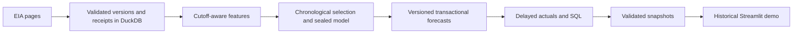
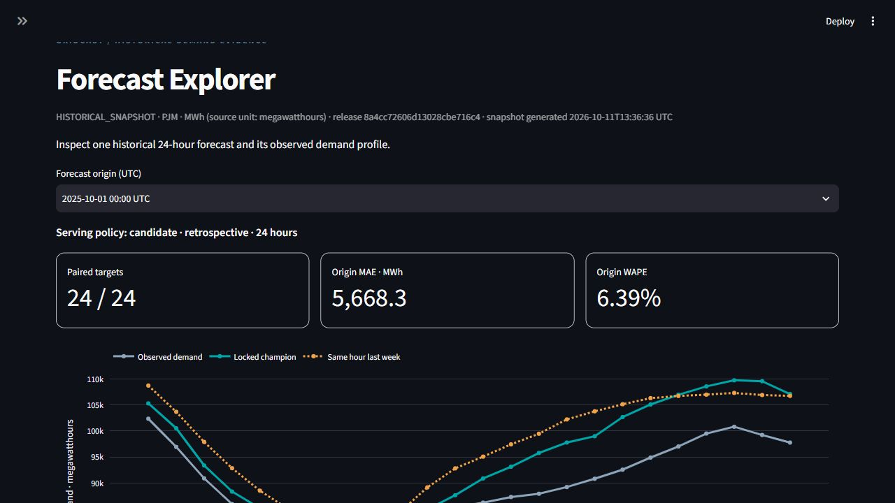
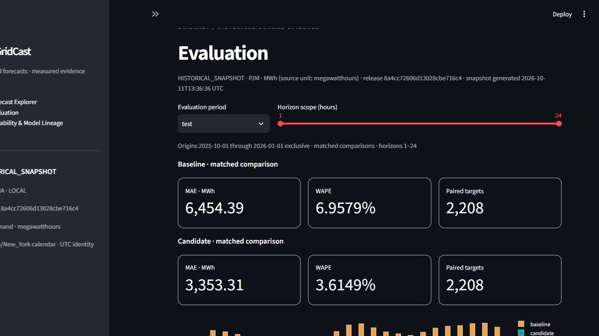
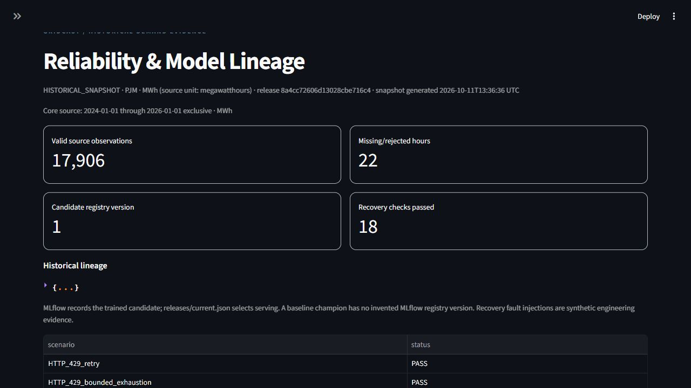

# GridCast - Electricity Demand Forecasting & Analytics

GridCast forecasts PJM demand for the next 24 hourly UTC interval ends and preserves the inputs, model identity, predictions, and later actuals needed to explain each batch. It demonstrates temporal data engineering, model lifecycle management, transactional scoring, and SQL analysis through a portable historical dashboard. Intended use is planning and error inspection; no dispatch or realized savings are claimed.

**Stack actually used:** Python, SQL, requests, pandas, NumPy, PyArrow/Parquet, DuckDB, scikit-learn, MLflow with SQLite/local artifacts, Joblib, Pydantic, PyYAML, Streamlit, Plotly, pytest, Ruff, Git, and GitHub Actions. Snowflake assets are prepared manual integration work, not an executed integration.

## Architecture



MLflow tracks experiments; an immutable release bundle and `releases/current.json` select serving. The dashboard reads snapshots, with no database, model, MLflow server, or credentials required. Its examples come from saved test predictions; operational database batches supply health evidence. See [the authoritative implemented architecture](architecture.md) for components, schemas, algorithms, worked examples, recovery boundaries, and interview answers.

## Verified scale and forecasting results

The source is EIA API v2 `electricity/rto/region-data`, respondent **PJM**, type **D**, hourly, in **megawatthours (MWh)**. Labels are UTC interval ends, normalized without an hour shift; calendar features use America/New_York.

| Scope, half-open UTC period | Expected hours | Valid observations |
| --- | ---: | ---: |
| Core: 2024-01-01 to 2026-01-01 | 17,544 | 17,522 |
| Warm-up: 2023-12-18 to 2024-01-01 | 336 | 336 |
| Label padding: 2026-01-01 to 2026-01-03 | 48 | 48 |
| Padded total | 17,928 | 17,906 |

Core coverage is **17,522/17,544 = 99.8746%**. Twenty-six extraction windows delivered 17,928 versions and receipt links, including 22 invalid/missing hours. Repeated deliveries are not extra unique observations; no revised real identities were observed in this retrieved snapshot. See [source validation](docs/evidence/source_validation.json) and [extraction evidence](docs/evidence/source_fetch_summary.json).

**Historical availability assumption:** data was collected in October 2026. Results simulate availability three hours after each interval end; historical publication vintages were not reconstructed.

| Matched scope | Baseline WAPE | Candidate WAPE | Baseline MAE, MWh | Candidate MAE, MWh | Paired origins / scheduled | Targets |
| --- | ---: | ---: | ---: | ---: | ---: | ---: |
| Validation: Jul-Sep 2025 | 9.7199% | 3.8259% | 10,047.56 | 3,954.88 | 89 / 92 | 2,136 |
| Frozen test: Oct-Dec 2025 | 6.9579% | 3.6149% | 6,454.39 | 3,353.31 | 92 / 92 | 2,208 |

Four configurations across three expanding folds selected the candidate: **60.6384% relative validation WAPE reduction**, with the predeclared peak-error and coverage gates also satisfied. Three month-end validation origins were purged for label availability. Selection and the final fitted artifact were sealed before the first test evaluation. WAPE uses total absolute error divided by total absolute actual demand, not averaged fold percentages. Raw candidate results exclude fallback. Detailed splits, bias, peak metrics, denominators, model identities, and limitations are in the [model card](docs/model_card.md), [selection receipt](docs/evidence/selection.json), and [test receipt](docs/evidence/test_result.json).

## Measured analytical findings

All findings below concern **October-December 2025**, under the historical availability assumption, and are observations rather than business savings:

- **Horizon 13** had the largest candidate test MAE: **4,607.81 MWh across 92 matched targets**. This identifies a part of the daily profile for review. [Horizon output](docs/evidence/sql/error_by_horizon_test_candidate.csv)
- Candidate test WAPE was **3.6149% across 2,208 matched targets**, using **204,822,410 MWh** as the summed absolute-actual denominator. [Test metrics](docs/evidence/test_result.json)
- Above the final training-derived **118,411.4 MWh** peak threshold, candidate peak MAE was **9,521.12 MWh across 67 targets**. Peak error materially exceeds average error. [Peak output](docs/evidence/sql/peak_demand_error_test_candidate.csv)

Four parameterized SQL queries cover horizon error, peak error, seasonality, and source/model health. Ten scoped outputs were independently reconciled with NumPy. [Query/scope receipt](docs/evidence/analysis.json) and [SQL](sql/).

## Setup and run

Executed environment: **Windows x64, PowerShell, Python 3.14.7**, project-local `.venv`, two CPU threads. Exact versions are in [the environment receipt](docs/evidence/environment.json) and dependency locks. Python 3.12/3.13 are permitted by metadata but were not locally verified. Reuse the supplied environment when it already exists.

```powershell
# From the GridCast directory, for a new environment only:
python -m venv .venv
New-Item -ItemType Directory -Force -Path state\tmp,state\matplotlib | Out-Null
$env:TEMP = (Resolve-Path state\tmp).Path
$env:TMP = $env:TEMP
$env:MPLCONFIGDIR = (Resolve-Path state\matplotlib).Path
.\.venv\Scripts\python.exe -m pip install -r requirements\local.windows-py314.lock.txt
.\.venv\Scripts\python.exe -m pip install --no-deps -e .
.\.venv\Scripts\python.exe -m pip check
```

Launch the packaged demo without credentials:

```powershell
Remove-Item Env:EIA_API_KEY -ErrorAction SilentlyContinue
.\.venv\Scripts\python.exe -m streamlit run app\streamlit_app.py --server.address 127.0.0.1 --server.port 8501 --browser.gatherUsageStats false
```

Open [localhost:8501](http://127.0.0.1:8501). Use another explicit port if occupied. If desktop sandbox socket restrictions prevent launch, run the command in your own PowerShell.

A reproducible **synthetic** fixture uses a new isolated root; its accuracy is not a portfolio result:

```powershell
.\.venv\Scripts\python.exe -m gridcast run --mode build --fixture --compact --offline --root state\my-clean-fixture --config config\fixture.yaml --splits config\fixture_splits.yaml
.\.venv\Scripts\python.exe -m gridcast verify-scenarios --root state\my-clean-fixture --config config\fixture.yaml
.\.venv\Scripts\python.exe -m gridcast validate-demo --root state\my-clean-fixture --config config\fixture.yaml
.\.venv\Scripts\python.exe -m ruff check src app tests scripts snowflake
.\.venv\Scripts\python.exe -m pytest -q
```

For real ingestion, [register an EIA key](https://www.eia.gov/opendata/register.php) and set it privately in the launching process. A fresh independent reproduction belongs in a **new root**; later EIA revisions may differ from the saved snapshot:

```powershell
$env:EIA_API_KEY = [System.Net.NetworkCredential]::new('',(Read-Host 'EIA key' -AsSecureString)).Password
.\.venv\Scripts\python.exe -m gridcast run --mode build --root state\my-real-reproduction --config config\project.yaml --splits config\splits.yaml
```

For an existing workspace whose code/dependencies match its seal, `run --mode build --offline` verifies/reuses the saved source and selection. Daily scoring/replay uses `run --mode daily --offline --origin 2025-10-01T00:00:00Z`; it does not train. `export-demo` retries publication after database success; `rollback --release-id <EXISTING_VALIDATED_ID>` selects an existing bundle. `python -m gridcast --help` lists all commands; [run_local.ps1](scripts/run_local.ps1) is the PowerShell runner. Never delete a seal to bypass a mismatch. The existing holdout has been viewed, and local code fixes require their own provenance rather than inheriting historical performance.

Runtime paths: `data/db/gridcast.duckdb`, `state/mlflow.sqlite`, `state/mlflow_artifacts`, `state/candidate.joblib`, and `releases/current.json`. They remain local/ignored. The analyzer may regenerate ignored `docs/business_findings.md`; this README owns the maintained narrative and links its compact evidence.

## Dashboard walkthrough

1. **Forecast Explorer:** choose 2025-10-01 00:00 UTC; inspect all 24 targets from 01:00 to the next midnight, candidate, weekly baseline, and actuals attached after scoring. Expand timestamp rows and read origin-specific errors.
2. **Evaluation:** test scope has 2,208 matched targets per model. Set horizons to 1-12: paired counts become **1,104 per model**, and MAE/WAPE recompute from scoped sums. Restore 1-24; validation has 89/92 paired origins and 2,136 targets. Peak/coverage scopes stay explicitly labeled.
3. **Reliability & Model Lineage:** distinguish source period, collection date, fit cutoff, model version, release, snapshot generation, and checksum. The 18 recovery cases are synthetic; health is historical, not a live outage alert.

The published demo contains **168 saved-test forecast examples and 96 metric rows** in six payload files totaling 110,706 bytes, excluding manifest/pointer and screenshots. [Snapshot receipt](docs/evidence/published_demo.json).

Genuine captures from the running app:







[Browser interaction receipt](docs/evidence/browser_checks.json). Streamlit AppTest renders every view and verifies the filter with EIA credentials removed, HTTP/external network blocked, and model loading forbidden; framework loopback IPC remains available.

## Reliability and validation

Local MLflow records **13 finished runs** (12 validation fits plus the final fit), two retained failed attempts, and registered candidate version 1. Serving validates the release checksum and resolves the authoritative pointer once per batch. [MLflow receipt](docs/evidence/mlflow.json).

Seven historical batches contain **168 forecasts**. Recorded replay added zero forecast, feature, lineage, or error rows; it added an execution attempt. A failed forecast transaction rolls back its writes, while export failure preserves the previous valid demo pointer. **18 isolated synthetic recovery scenarios passed**, including incomplete source windows, corrupt-model fallback, unavailable inputs, interrupted writes, rollback, and revised actuals. These finite checks do not prove universal exactly-once behavior or production safety. [Replay](docs/evidence/daily_replay.json), [recovery](docs/evidence/recovery.json), [leakage](docs/evidence/trained_candidate_leakage.json).

Original sealed-release local suite: **44 passed**. During cleanup, the current checkout including uncommitted fixes had **135 passed**; an isolated published-source tree had **43 passed, 1 skipped**, with the skip requiring private real-build state. Ruff, dependency, CLI, demo, and credential-free dashboard checks passed. [Original JUnit](docs/evidence/pytest-final.xml), [scoped cleanup checks](docs/evidence/cleanup_checks.json), and [local fix ledger](docs/bug_audit.md). Those 135 tests are not attributed to the published pipeline.

The original hosted workflows **failed**: the [first inspected Ubuntu run](https://github.com/PuravDesai004/GridCast/actions/runs/38145773653) failed Windows-drive path containment; the [cleanup run at 50e93f7](https://github.com/PuravDesai004/GridCast/actions/runs/38151159704) also failed overall. The Windows-drive containment defect now has a portable-path fix and 13 focused regression cases. An isolated published-source tree with that fix passed 56 tests with one private-real-state skip; Ruff passed. The [follow-up Ubuntu run](https://github.com/PuravDesai004/GridCast/actions/runs/38210511471) at `bf1b3dd` passed all workflow steps, with **56 tests passed and one private-real-state skip**. [Verified follow-up receipt](docs/evidence/hosted_ci_followup.json). No keys or historical downloads are required by the workflow.

## Limitations and pending work

- Retrospective 2026 retrieval with simulated three-hour availability is not prospective accuracy or reconstructed provider publication history.
- One authority, a limited period, missing hours, correlated horizons, peak error, no weather features, and no uncertainty intervals limit generalization.
- Local files/databases and finite fault tests do not establish distributed concurrency, production SLAs, access control, or dispatch safety. Checksums establish consistency; trusted Joblib/cloudpickle artifacts must not be replaced with arbitrary models.
- No service deployment or background schedule exists. Real prospective collection and broader validation remain pending; the offline Ubuntu workflow is verified separately.
- **Snowflake is unexecuted.** [The manual guide](docs/snowflake_steps.md) and [scripts](snowflake/) prepare setup, load, feature/prediction parity, registry inference, outcomes, exports, and cleanup. Account compatibility, execution, parity, and costs require user-run evidence. They are not resume accomplishments.

## Documentation and evidence

- [architecture.md](architecture.md): the single implemented architecture, worked examples, trade-offs, and viva answers; historical source is distinguished from local fixes.
- [Model card](docs/model_card.md): source/feature/split/evaluation/fallback contract and immutable model identities.
- [Requirement-to-evidence matrix](docs/completion_matrix.md): implementation mapping and verification boundaries.
- [Resume evidence](docs/resume_evidence.md): defensible numerical claims and interview explanations.
- [Bug audit](docs/bug_audit.md): unique uncommitted fixes and unresolved publication/CI boundaries.
- [Evidence index](docs/evidence/index.json): original receipt checksums; additional review receipts remain separately identified in [docs/evidence](docs/evidence/). Original receipts and immutable release/demo cards are unchanged.

Personal Project Viva Coach tooling remains intact locally under `.agents/skills/project-viva-coach/` and is excluded from GitHub; no application or workflow depends on it. The earlier guide/PDF is retained as dated reference material outside the checkout.

Earlier cleanup provenance remains in [its receipt](docs/evidence/cleanup_checks.json) and [commit 50e93f7](https://github.com/PuravDesai004/GridCast/commit/50e93f7f896804701de009471fa9cb12a0f0639d). Original documents are recoverable from Git and verified outside-repository backups. Recoverable archives are organized under `../GridCast_local/backup/`; extract selected files to an isolated directory before restoring them.

Local organization: `data/`, `state/`, `releases/`, and `reports/` retain offline source, databases, model artifacts, provenance, and export inputs in their established paths. The sibling `../GridCast_local/` holds `reference/` (dated teaching material), `review/` (unique historical audit results), and `backup/` (verified recovery archives). Current cleanup bookkeeping is confined to ignored `state/organization-review/`.

Read-only integrity check: `python scripts/check_release.py` verifies public evidence/demo plus the local serving bundle; use `--public-only` in a fresh clone. It never loads the model or rewrites receipts. `python scripts/package_public.py --ref HEAD --output state/public-source.zip` packages an exact committed Git tree without including ignored runtime files or changing evidence. Choose a new archive path each time. Original one-time environment/final-audit scripts are archived locally; historical evidence remains unchanged.
