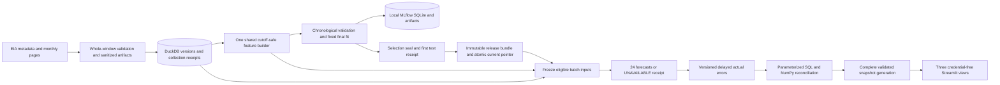
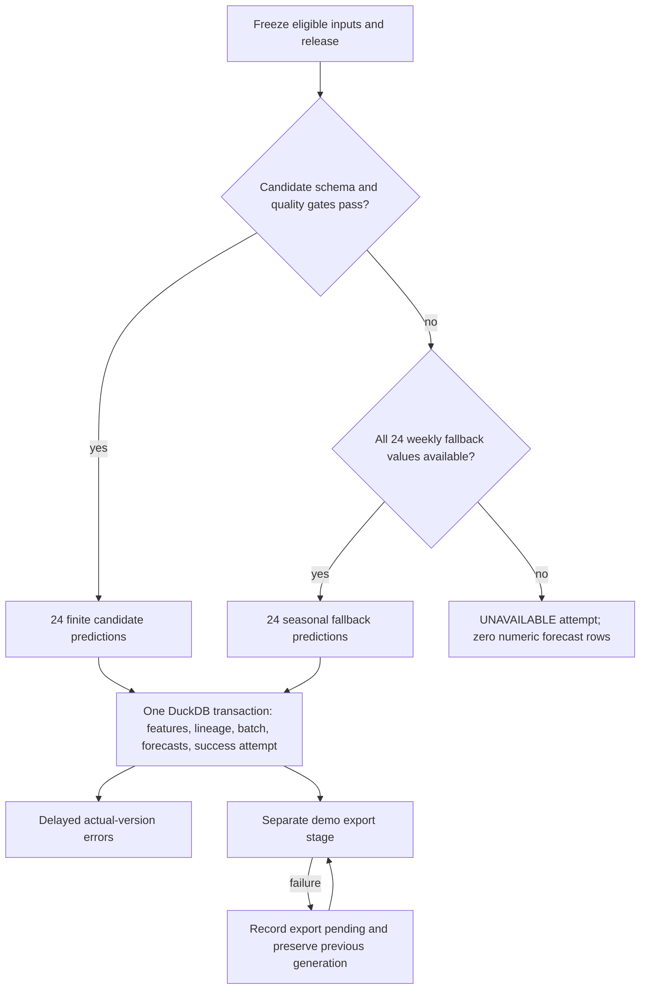

# GridCast: implemented architecture and teaching guide

GridCast turns collected hourly PJM demand into a reproducible daily 24-hour forecast. Its main engineering question is: **what was allowed to be known when this forecast was made?** It records the inputs, model identity, forecast values, actual versions, and failures needed to answer that question.

This describes code and execution in this workspace. `docs/proposed_architecture.md` preserves the supplied proposed specification. The source is REAL_EIA; recovery cases are separately labeled synthetic. Snowflake and Linux hosted CI remain unexecuted.

## Modules, state, and ownership

| Owner/module | Responsibility | Key grain/state |
|---|---|---|
| `source.py` | Metadata, EIA v2 requests, bounded retries/pagination, complete cache windows | Sanitized content artifact hash; separate successful fetch ID |
| `storage.py` | Typed demand versions, receipt chronology, current/as-of views, gap checks | Authority × metric × UTC interval end × value/unit version; fetch × version delivery |
| `features.py` | Training and inference share exact ordered 26-feature schema | Origin snapshot × horizon; lineage expands to snapshot × horizon × feature × version |
| `training.py` | Membership, label availability, expanding fits, search, MLflow, seal/test | Fit cutoff, fold, configuration, candidate checksum |
| `evaluation.py` | Paired metrics/selection and later actual vintages | Forecast identity × horizon × actual version × policy |
| `releases.py` | Validate immutable bundle, atomic promotion, rollback, alias reconciliation | `releases/current.json` authoritative; MLflow alias is a mirror |
| `forecasting.py` | Freeze inputs, gates, fallback, replay, atomic batch transaction | Release × origin × eligible-input snapshot × requested/actual serving path |
| `analysis.py`, `sql/` | Four scoped analyses and independent metric sums | Split/model/horizon, peak/hour/weekday, seasonality, health |
| `snapshots.py`, `app/` | Atomic generation publication and small validated offline reads | Manifest/checksums and one generation pointer |
| `workflow.py`, `cli.py` | Actual stage graph, durable stage receipts, fail exits | Build versus daily; daily never trains or evaluates the holdout |
| `scenarios.py`, `tests/` | Isolated fault injections and contract checks | Before/after counts/checksums; fixture source labeled synthetic |

Runtime databases, historical downloads, fitted pickles, lineage gzip files and release bundles stay local/ignored. Compact sanitized receipts, SQL CSVs, screenshot images, source/config/scripts, and the current small dashboard generation are public-ready. User-run warehouse scripts are separate and never imported by a local GridCast operation.

## Source meaning and collection evidence

Official API v2 route is `electricity/rto/region-data`; respondent PJM, type D, hourly. API values say **megawatthours**. EIA-930 hourly labels are UTC **interval ends**; `2025-10-01T01` normalizes to `2025-10-01 01:00:00+00:00`, without adding an hour. Display/calendar is America/New_York. The API's inclusive end was verified and translated to internal half-open windows. Sources and sanitized probe evidence are in `docs/evidence/source_contract.json` and `source_metadata.json`.

| Source scope | Interval ends | Valid observations |
|---|---|---:|
| Warm-up | 2023-12-18 00:00 through 2024-01-01 00:00 exclusive | 336 |
| Core | 2024-01-01 00:00 through 2026-01-01 00:00 exclusive | 17,522 |
| Label padding | 2026-01-01 00:00 through 2026-01-03 00:00 exclusive | 48 |
| Total | Padded half-open interval, 17,928 expected hours | 17,906 |

Twenty-six monthly windows delivered 17,928 versions; 22 null/invalid values were retained and reported as missing, rather than interpolated. The gap spans 2024-03-10 07:00 through 2024-03-11 04:00 UTC inclusive. Zero and extreme-positive version counts are both zero; observed real multi-version identities are zero. Those facts do not mean EIA never revises demand: this one collection does not reconstruct older publication vintages. Actual October 2026 receipt times are preserved; no fetch was backdated.

Source validation snapshot hash is `30cbfaaf297b4f373d5a71be35a00560960960f81550861b3dab8489bbd99e08`. That logical source hash differs from the frozen Parquet file's byte checksum. Canonical raw artifacts are sanitized before hashing (`redact_v1`); their SHA-256 identifies persisted sanitized content, not unredacted wire bytes. Identical repeated content retains new fetch/receipt chronology. Conflicting same-key pages invalidate a whole staged window.

## A real origin becomes 24 rows

For **C = 2025-10-01 00:00 UTC**, each target is `C + h hours`, h=1…24. Under retrospective +3h availability, the latest eligible interval end is **2025-09-30 21:00 UTC**, value **108,034 MWh**. Its simulated availability is exactly C and anchor age is three hours. The observations at 22:00, 23:00 and 00:00 exist in the frozen file but remain unavailable to this forecast.

The 24/168-hour windows are `(anchor−N hours, anchor]`; this origin has 24 and 168 values. Standard deviation is population stddev, ddof=0. Each target also joins its own lag timestamps. Many eligible observations contribute to a batch; one anchor alone does not supply it.

| Horizon | Target UTC | 168h lag timestamp/value, MWh | 336h lag timestamp/value, MWh | Locked candidate, MWh |
|---:|---|---|---|---:|
| 1 | Oct 1 01:00 | Sep 24 01:00 / 108,740 | Sep 17 01:00 / 101,849 | 105,306.1479 |
| 6 | Oct 1 06:00 | Sep 24 06:00 / 85,031 | Sep 17 06:00 / 79,005 | 80,185.0976 |
| 24 | Oct 2 00:00 | Sep 25 00:00 / 106,760 | Sep 18 00:00 / 105,173 | 107,110.3773 |

These are actual feature/prediction values from `docs/evidence/worked_origin.csv`, using the sealed final candidate. Target actuals are attached **after** scoring, never passed to the feature/predict interface. Features include deterministic local calendar/cycles, horizon, 168/336-clock-hour target lags, latest eligible demand/age, 24/168-hour mean/std/min/max/count, and anchor minus the value 24 clock hours earlier. Ordered feature names and float64 dtypes are in `features.py` and the release manifest.

## Cutoffs, gaps, DST, and revisions

At C, `observation_time+3h<=C` governs retrospective inputs. Prospective inputs instead require an actual successful collector receipt by C, with latest fetched_at/delivery_order selecting the valid version. The frozen historical source is a present collection, so retrospective accuracy is conditional on its revision state and declared delay assumption.

Timestamp joins preserve missing hours. A missing Sep 24 01:00 value leaves horizon 1's lag missing; row shifting would wrongly substitute another hour. Native NaN handling is allowed for candidate lags when gates pass; complete seasonal fallback still requires all 24 weekly values. No unsafe target lag1/lag24, interpolation, or invented zero labels exists.

Illustrative timezone examples, also exercised by tests: March 10, 2024 at 06:00 UTC is 01:00 EST (offset −5); 07:00 UTC is 03:00 EDT (offset −4). November 3 at 05:00 and 06:00 UTC are both local 01:00, but offsets −4/−5 and fold 0/1 distinguish them. UTC forecast identities remain unique.

Illustrative/synthetic revision example: an interval's A is collected, then B, then A again. Earliest first_seen of A cannot determine latest known demand. The receipt stream picks B after its receipt and A after its reversion receipt; old versions/deliveries remain. `docs/evidence/recovery.json` proves two versions/four repeated/reverted receipts, while real revision identities in this snapshot are zero.

Leakage checks mutate/append/delete/reorder unavailable rows, including delayed observations before C. Real trained-candidate feature values, eligible hashes and predictions stay unchanged (`trained_candidate_leakage.json`). Prospective after-C revisions are separately injected in `leakage.json`. A full source artifact/value hash can change without changing the eligible-input identity, so unrelated future changes do not create a different logical forecast replay key.

## Fitting, selection, sealing, and test

Membership is assigned by origin; labels separately require `target+3h<=fit_cutoff`. There is one global HistGradientBoostingRegressor with seed 42, early_stopping=False and max_iter 150. Four configurations compare leaves 15/31 and L2 0/1. Fits run sequentially with two CPU threads. No learned scaler/imputer or random internal validation is used.

| Stage | Origins | Cutoff / scoring boundary | Relevant counts |
|---|---|---|---|
| First expanding fit | Jan 2024–Jun 2025 | Fit at Jul 1 2025 | 12,915 usable label rows |
| July validation | Jul 1–31 | Labels available by Aug 1 | 30 paired of31; Jul 31 excluded |
| August validation | Aug 1–31 | Labels available by Sep 1 | 30 paired of31; Aug 31 excluded |
| September validation | Sep 1–30 | Labels available by Oct 1 | 29 paired of30; Sep 30 excluded |
| Fixed final fit | Jan 2024–Sep 2025 | Oct 1 2025 | 15,123 usable rows, 631 quality-eligible origins of639 scheduled |
| Frozen test | Oct 1–Dec 31 2025 | Evaluated only after seal | 92/92 paired origins, 2,208 targets |

Each validation month's final origin has only21 labels available at the next midnight, so it is excluded from complete paired selection. Native candidate/baseline eligibility covers all92 validation origins, but matched complete-label selection covers89 (96.7391%). The metric field `missing_actual_targets=3` in each fold describes cutoff-unavailable labels, not new source gaps.

The final fit's 25 missing/unavailable label rows comprise 22 real missing values and 3 boundary labels. Its partially purged origins are March 10/11 2024 and September 30 2025. Candidate quality gates exclude eight origins, March 11–18 2024: March 11 has a stale anchor; March 12 has deficient recent and weekly coverage; March 13–16 have deficient weekly coverage; March 17 has weekly and week-lag failures; March 18 has deficient week-lag coverage. Baseline remains complete for March 11–16 but fails March 17–18. These are feature-quality exclusions, separate from the three validation-boundary purges. Exact membership is preserved locally in `state/split_membership.json`, with a byte hash sealed, and compact exclusions in `docs/evidence/membership_summary.json`. No January 2026 guard label enters fitting; latest fitted target is September 30 21:00 UTC.

Validation chose leaves 15/L2= 1. Candidate WAPE3.8259% versus baseline9.7199%, a60.6384% relative reduction; candidate peakMAE5,130.83 versus12,007.23 MWh on502 training-defined high-demand targets;89/92 paired-origin coverage passes90%. The fixed rules demand >=2% relative WAPE improvement, peakMAE<=1.05×baseline and coverage>=90%. Undefined comparisons retain the valid baseline.

The seal includes relevant prediction code/config/dependency hashes, source/feature/membership identities, availability/schema/quality/clipping/peak/fallback policies, search and decision, and the fitted artifact **before** viewing test labels. `evaluate-test` rejects a missing/changed seal. Its first receipt at2026-10-11 13:12:20.398108 UTC is retained; equal reruns reuse it. No prediction-affecting repair or tuning occurred after test evaluation. Packaging/UI/manual-script fixes did not change sealed prediction code or test results.

| Frozen test | Baseline | Candidate |
|---|---:|---:|
| MAE, MWh | 6,454.3931 | 3,353.3136 |
| WAPE | 6.9578812% | 3.6148957% |
| Signed bias (prediction−actual), MWh | −294.8478 | −727.9941 |
| Absolute error sum, MWh | 14,251,300 | 7,404,116.4099 |
| Sum absolute actual, MWh | 204,822,410 | 204,822,410 |
| Peak MAE, MWh / targets | 13,128.4478 /67 | 9,521.1243 /67 |

MAE is summed absolute error/count. WAPE is100×summed absolute error/summed absolute actual, with zero denominator explicitly unavailable. Peak threshold is the final training-label90th percentile **118,411.4 MWh**, never recalculated from test labels. No confidence interval treats adjacent horizon rows as independent. Test missing actuals, quality-failed origins and clipped candidate targets are allzero. Raw candidate comparison excludes fallback predictions.

## Registry, releases, transactions, and recovery

MLflow tracks fits, parameters, provenance, cutoffs, metrics, split/leakage artifacts, versions and measured durations in project-resolved SQLite/local artifacts. The actual fixed candidate is registered as `GridCast_PJM_Candidate` version 1. The seasonal baseline has no invented registry version. Trusted local model serialization uses cloudpickle; only checksum-verified artifacts are loaded. Failed setup runs remain visible rather than erased.

Serving release **8a4cc72606d13028cbe716c4** contains ordered schema/dtypes, fitted checksum, policies, source/seal/test identities and a model card. One atomic pointer is authoritative. A request resolves it once. The champion alias is a reconciliable mirror; it cannot independently choose serving. Failed promotion preserves the prior pointer; rollback validates an explicit existing bundle before replacing it.

Gates are anchor age<=6h, recent count>=22/24, weekly count>=160/168, weekly target-lag count>=22/24, valid release/schema. Candidate artifact corruption can invoke complete baseline fallback without loading the corrupt pickle. Otherwise UNAVAILABLE has no fake zeros. Nonnegative clipping v1 is shared with evaluation; clipping counts are reported.

Logical replay verifies equal output checksum and insertszero forecast rows; each attempt remains visible. Different eligible inputs/release create a labeled new identity. An injected horizon 12 failure rolls back every forecast/feature/lineage write and records the failed attempt afterwards. Real daily replay preserved168 forecasts,168 outcomes,7 logical batches and the model/seal/test hashes, adding only an attempt. Historical actual revisions create new error vintages without editing forecasts.

Eighteen isolated synthetic recovery checks passed, including HTTP429/backoff/exhaustion, partial pages, same-key conflict, revisions/reversion, replay, stale/missing lags, corrupt model, rollback/promotion, interrupted DB transaction, and export failure/retry. Counts/checksums and expected/actual outcomes are in `docs/evidence/recovery.json`.

## Analysis, dashboard, reproduction, and limitations

Four parameterized DuckDB queries preserve scopes, SQL hashes and CSV output. NumPy sums reconcile selected results. The measured candidate's worst test horizon is13 (MAE4,607.81 MWh over92 targets); peak demand MAE9,521.12 MWh on67 targets remains materially larger than the overall MAE. Those observations suggest where to inspect error, not procurement savings or operational readiness.

Dashboard reads small snapshots only, validates containment/checksums/sizes/schema/keys/UTC dates/horizons/metric arithmetic, and labels every view historical with units/dates/release. Horizon filters recompute numerator/denominator sums; unchanged origin coverage and peak scopes are labeled global. Atomic generation pointers preserve the previous valid dashboard on failed export. AppTest forbids external network, HTTP and model loading; the browser rendered allthree views and controls, with genuine captures.

See README for exact clean setup, isolated fixture, real build/cache resume, daily/replay, recovery and launch commands. A fresh real collection can differ because of EIA revisions; retain this first evaluation's evidence instead of comparing untracked states. Prospective collection semantics are implemented/tested, but no live prospective accuracy period has been demonstrated. Source gaps, absent weather, one authority, point forecasts only, correlated horizon errors and the simulated publication delay limit interpretation.

Snowflake scripts are user-run only; feature/runtime/warehouse prediction parity and cost evidence remain pending. Hosted Linux CI and publication are pending. No external resource or schedule was created. Local completion is independent of those optional steps.

## Interview questions and defensible answers

- **Why timestamp joins?** Missing hours and DST cannot shift a clock-hour lag to another time. The real22-hour missing block stays missing.
- **How did you prevent leakage?** One cutoff-safe builder, separate label attachment, actual collector chronology in prospective mode, purged boundary origins, sealed test, and unavailable-row/revision mutation checks with equal predictions.
- **Why choose the candidate?** It passed fixed validation gates with60.64% relative WAPE reduction, better peakMAE and96.74% complete paired-origin coverage, before the holdout was viewed.
- **Why MLflow and a release pointer?** MLflow records experiments and trained artifacts. A validated immutable serving bundle and atomic current pointer determine operational identity and rollback.
- **What happens when demand is missing?** Quality gates choose candidate, complete seasonal fallback, or an explicit unavailable batch. No interpolation or fake zero forecast appears.
- **What did you prove in the database?** Replay insertszero forecasts; a horizon 12 exception rolls back the batch; changed actuals create new error vintages; export failure preserves both committed forecasts and the previous demo generation.
- **What is still pending?** Real prospective collection/accuracy, user-run Snowflake compatibility and parity, hosted Linux CI and publication. Historical retrospective performance is the executed portfolio result.
