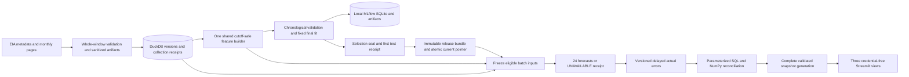

# GridCast: implemented architecture and viva guide

This is the authoritative technical architecture. Start with the [README](README.md) for purpose, results, setup, and the dashboard walkthrough; use the [model card](docs/model_card.md) for evaluation contracts and [resume evidence](docs/resume_evidence.md) for numerical claims.

**Evidence boundary:** The explanations and saved worked examples describe published source `8b2137243801bada4aad48989080daa9cc5e4cdf` and its preserved release. Its prediction modules match the original selection seal. Later local pipeline fixes remain uncommitted and have a separate [audit](docs/bug_audit.md); their current source does not match that historical seal. Documentation consolidation does not retrain, refresh source, reevaluate the holdout, or promote a release.

**Status vocabulary:** [IMPLEMENTED] means present in that referenced source, not production readiness. [INFERRED] identifies explanatory reasoning; [PLANNED] identifies future work; [DOCUMENTED BUT NOT VERIFIED] identifies an external execution without evidence; [LIMITATION] identifies a known boundary. Historical accuracy, synthetic fault tests, local fixes, and hosted CI have separate scopes.

**Reading route:** components and data flow → cutoff and learning logic → worked examples and schema → call chains and recovery → security and future scope → viva answers. The source index links to the exact historical functions rather than attributing the saved results to later edits.


## Contents

- [Complete system components](#complete-system-components-implemented)
- [Source semantics and collection identity](#source-semantics-and-collection-identity-implemented)
- [Follow one forecast end to end](#follow-one-forecast-end-to-end-implemented)
- [What happens when...](#what-happens-when-implemented)
- [The core logic](#the-core-logic-implemented)
- [Where ML is used, and where it is not](#where-ml-is-used-and-where-it-is-not-implemented)
- [Architectural decisions and trade-offs](#architectural-decisions-and-trade-offs-implemented--inferred)
- [Worked examples](#worked-examples-implemented)
- [Clock-hour gaps, DST, and revision boundaries](#clock-hour-gaps-dst-and-revision-boundaries-implemented)
- [Data, schema, and chronological membership](#data-schema-and-chronological-membership-implemented)
- [Code structure and important call chains](#code-structure-and-important-call-chains-implemented)
- [APIs and interfaces](#apis-and-interfaces-implemented)
- [Error handling and recovery](#error-handling-and-recovery-implemented)
- [Verification scopes](#verification-scopes-implemented--limitation)
- [Security and reliability boundaries](#security-and-reliability-boundaries-implemented--limitation)
- [Limitations you should state first](#limitations-you-should-state-first-limitation)
- [Current versus future scope](#current-versus-future-scope-implemented--planned)
- [Viva questions and answers](#viva-questions-and-answers-implemented--inferred)
- [Master mental model](#master-mental-model-implemented)
- [Source index](#source-index-implemented)




## Complete system components [IMPLEMENTED]

### CLI and orchestration [IMPLEMENTED]

**What/why:** `cli.py` validates commands and configuration; `workflow.py` connects stages into build and daily paths. This makes the work repeatable outside a notebook.

**How/input/output:** argparse parses timestamps, source bounds, workspace root, fixture/offline flags, and release ID. Pydantic rejects unknown or invalid settings before pipeline mutation. `stage()` records a unique receipt, status, duration, and sanitized failure type. `run()` executes dependency-ordered operations and returns the final snapshot validation result.

**Dependencies/failure:** Calls source, storage, training, forecasting, analysis, and snapshot modules. A stage exception is recorded and propagated; the CLI returns exit code 1. A partially completed build keeps successful receipts. **Alternative [INFERRED]:** Airflow or another scheduler could orchestrate stages, at greater infrastructure cost. **Limitation:** No schedule or multi-worker coordination is implemented.

Sources: src/gridcast/cli.py:parser, execute, main; src/gridcast/workflow.py:stage, run; config.py:Settings.

### EIA ingestion and cache [IMPLEMENTED]

**What/why:** `source.py` consumes the EIA v2 region-data API and stages a complete bounded window before publication. It avoids treating a partial response as a successful extraction.

**How/input/output:** Metadata verifies PJM, demand type D, hourly UTC semantics, and source units. The client requests sorted pages and checks totals, bounds, facets, duplicates, and conflicts. Ingestion breaks the padded period into monthly half-open windows. Sanitized JSON artifacts, cache records, and collection receipts identify each completed extraction.

**Dependencies/failure:** Uses requests, pandas, storage publication, and hash/redaction helpers. Retryable network/HTTP failures have a bounded retry budget; invalid contracts stop the stage. Offline mode requires verified caches. **Alternative [INFERRED]:** Bulk EIA files could replace API pagination. **Limitation:** In this committed version, cache reuse verifies artifact bytes and reuses the receipt; it assumes the corresponding database delivery remains present. It is not a full database rebuild mechanism.

Sources: src/gridcast/source.py:EIAClient.request, EIAClient.window, inspect_source, ingest.

### Observation history and DuckDB [IMPLEMENTED]

**What/why:** `storage.py` separates "what value existed" from "when this collector received it." That separation is essential for revisions and as-of selection.

**How/input/output:** Normalization enforces PJM/D, hourly UTC, and MWh. A content-derived version ID includes authority, metric, time, raw value, and unit. A successful fetch has its own ID and delivery order. Publication inserts versions and delivery links in a transaction. Views select a valid version using successful fetch chronology. Source validation checks artifact hashes and compares valid observations with the expected hourly grid.

**Dependencies/failure:** Used by ingestion, forecasting, and later outcomes. Failed database publication rolls back; invalid values remain recorded as rejected history rather than being filled. **Alternative [INFERRED]:** PostgreSQL could support a shared service. **Limitation:** This is a local database design; invalid latest revisions are retained as history, while the current view ranks valid delivered versions.

Sources: src/gridcast/storage.py:SCHEMA, normalize, publish_window, source_view, validate_source.

### Shared feature builder [IMPLEMENTED]

**What/why:** `features.py` creates the same ordered 26 columns for research and serving. It keeps target actuals outside its input interface.

**How/input/output:** Receives a source DataFrame, UTC-midnight origin, and settings. It filters observations by availability, chooses eligible versions, identifies the latest eligible anchor, and builds 24 horizon rows. Timestamp joins select 168/336-hour lags; anchor windows provide statistics and coverage. It returns a `FeatureBatch` containing features, hashes, snapshot ID, and lineage.

**Dependencies/failure:** Used by dataset building, scoring, and leakage checks. Missing inputs remain NaN or explicit coverage counts; quality gates determine whether the candidate may serve. **Alternative [INFERRED]:** Row-shift lags are simpler but can move the wrong hour across gaps. **Limitation:** Weather and other authorities are absent; availability in this historical run is simulated.

Sources: src/gridcast/features.py:FEATURES, FeatureBatch, build_features, gates.

### Training, selection, and MLflow [IMPLEMENTED]

**What/why:** `training.py` learns one global histogram gradient boosting model and compares it with a deterministic seasonal baseline. MLflow records fits and model provenance.

**How/input/output:** Receives frozen source and feature Parquet files plus chronological split settings. Four configurations each run July, August, and September validation folds. Fit labels must be available at each fit cutoff. Validation selects a configuration and applies fixed champion gates. A final pre-test fit is serialized, logged, registered, and sealed before final-test evaluation.

**Dependencies/failure:** Uses scikit-learn, NumPy/pandas, thread limits, MLflow, Joblib, and evaluation helpers. Insufficient training data or a changed/missing seal blocks the operation. **Alternative [INFERRED]:** A linear model would be simpler; a neural model would add complexity. **Limitation:** Four bounded configurations do not establish a globally optimal model, and the viewed holdout must not be reused for tuning.

Sources: src/gridcast/training.py:fit_rows, model_for, log_fit, backtest, seal_selection, evaluate_test.

### Release and serving [IMPLEMENTED]

**What/why:** `releases.py` turns a trained artifact into an identified serving bundle. `forecasting.py` resolves that release once and records one logical forecast batch.

**How/input/output:** A release contains ordered features/dtypes, policies, provenance, card, and artifact checksums. `releases/current.json` is authoritative; the MLflow champion alias is a mirror. Serving freezes eligible inputs, checks candidate gates, predicts or uses complete weekly fallback, and prepares 24 rows. Features, lineage, forecasts, batch status, and the success attempt share a transaction.

**Dependencies/failure:** Corrupt model artifacts can lead to seasonal fallback; missing fallback inputs produce UNAVAILABLE and zero numeric forecasts. Failed writes roll back. **Alternative [INFERRED]:** A remote model service could serve predictions, but requires service identity, authentication, and deployment. **Limitation:** There is no public prediction endpoint, production SLA, or tested concurrent multi-writer service.

Sources: src/gridcast/releases.py:validate_bundle, resolve_release, promote, create_release, rollback; forecasting.py:forecast.

### Outcomes, SQL, and dashboard [IMPLEMENTED]

**What/why:** `evaluation.py` attaches later actual versions without editing forecasts. `analysis.py` explains historical errors. Snapshots make that evidence portable.

**How/input/output:** Outcomes join authority, metric, target time, and unit, then insert errors keyed by actual version and policy. Four SQL analyses operate on explicit scopes. Export builds six payload files, validates the complete generation, and atomically changes its pointer. Streamlit loads one validated generation and recomputes scoped metric sums when filters change.

**Dependencies/failure:** Uses DuckDB/SQL, NumPy reconciliation, Parquet/CSV/JSON, Streamlit, and Plotly. Export failure preserves database commits and the prior published generation. Dashboard validation failure stops rendering with an error. **Alternative [INFERRED]:** A direct database dashboard could show live state, but would need database access. **Limitation:** This dashboard is a historical snapshot; it does not prove prospective operations.

Sources: evaluation.py:evaluate_outcomes; analysis.py:analyze; snapshots.py:validate_demo, export_demo, load_demo; app/streamlit_app.py.

### Check your understanding

1. Explain why the CLI and dashboard have different responsibilities.
2. What is the difference between an observation version, a serving release, and a dashboard generation?
3. Which part of the system learns from data, and which parts follow fixed rules?


## Source semantics and collection identity [IMPLEMENTED]


Official API v2 route is `electricity/rto/region-data`; respondent PJM, type D, hourly. API values say **megawatthours**. EIA-930 hourly labels are UTC **interval ends**; `2025-10-01T01` normalizes to `2025-10-01 01:00:00+00:00`, without adding an hour. Display/calendar is America/New_York. The API's inclusive end was verified and translated to internal half-open windows. Sources and sanitized probe evidence are in `docs/evidence/source_contract.json` and `source_metadata.json`.

See [README source scale](README.md#verified-scale-and-forecasting-results) for the period/count table.

Twenty-six monthly windows delivered 17,928 versions; 22 null/invalid values were retained and reported as missing, rather than interpolated. The gap spans 2024-03-10 07:00 through 2024-03-11 04:00 UTC inclusive. Zero and extreme-positive version counts are both zero; observed real multi-version identities are zero. Those facts do not mean EIA never revises demand: this one collection does not reconstruct older publication vintages. Actual October 2026 receipt times are preserved; no fetch was backdated.

Source validation snapshot hash is `30cbfaaf297b4f373d5a71be35a00560960960f81550861b3dab8489bbd99e08`. That logical source hash differs from the frozen Parquet file's byte checksum. Canonical raw artifacts are sanitized before hashing (`redact_v1`); their SHA-256 identifies persisted sanitized content, not unredacted wire bytes. Identical repeated content retains new fetch/receipt chronology. Conflicting same-key pages invalidate a whole staged window.


## Follow one forecast end to end [IMPLEMENTED]

The main action is `forecast` for origin `2025-10-01T00:00:00Z`. This is a historical demonstration; its actual execution occurred in October 2026. The origin describes the information cutoff, not the wall-clock execution time.

| Step | Component | Input -> action -> output |
|---|---|---|
| 1 | cli.py:execute | Command/timestamp -> validate settings and UTC midnight -> Workspace |
| 2 | releases.py:resolve_release | Pointer or release ID -> verify identity/schema/checksums -> bundle + corruption list |
| 3 | forecasting.py:forecast | Retrospective mode -> read frozen_source.parquet -> valid source frame |
| 4 | features.py:build_features | Source + origin -> filter available information -> 24 x 26 float64 frame + lineage |
| 5 | features.py:gates | Anchor/coverage -> candidate eligibility -> failure reasons |
| 6 | forecast model branch | Bundle + features -> candidate prediction or seasonal fallback -> 24 numbers / UNAVAILABLE |
| 7 | forecast transaction | Frozen identity + rows -> atomic inserts -> committed batch/attempt |
| 8 | evaluation.py:evaluate_outcomes | Later actual versions -> keyed comparison -> immutable error vintages |
| 9 | analysis.py:analyze | Saved validation/test pairs + demand + batch state -> scoped SQL -> CSVs/findings |
| 10 | snapshots.py / app | Saved test examples + metrics + health -> validated generation -> historical browser views |

**Where the data changes shape:** Raw API JSON becomes typed observation versions. A source DataFrame becomes a 24-row numeric feature matrix. Model output becomes forecast records with identity and unit. Later actuals become error vintages. Analytical rows become compact snapshot payloads.

```text
FeatureBatch
  frame: 24 rows x 26 ordered float64 columns
  origin: 2025-10-01 00:00:00 UTC
  snapshot_id, feature_hash, eligible_hash
  lineage: horizon / feature / version / available_at

Forecast record
  logical_id, authority=PJM, metric=D
  origin, target, horizon=1..24
  release_id, snapshot_id, prediction
  unit=megawatthours, mode=retrospective, serving_path
```

The feature builder cannot use the future target actual because it receives no label column or label interface. The later outcome join is a separate operation. The snapshot example is assembled from saved test predictions; it should not be described as the browser requesting live model inference.

Sources: cli.py:execute; forecasting.py:forecast; features.py:FeatureBatch; evaluation.py:evaluate_outcomes; snapshots.py:export_demo.


## What happens when... [IMPLEMENTED]

### You run a build [IMPLEMENTED]

The build verifies or prepares the source contract, ingests/validates data, and produces features and validation fits when no seal exists. It seals the final model, evaluates the holdout, publishes the release, and demonstrates seven forecast origins. Finally it attaches outcomes, analyzes results, and exports/validates snapshots.

```text
run --mode build -> source -> validation -> features
 -> backtest -> seal -> test -> release -> seven batches
 -> outcomes -> SQL -> export-demo -> validate-demo
```

If a selection seal already exists, the workflow skips new features/backtesting and verifies/reuses preserved selection and first-test evidence. A seal mismatch fails; it does not silently retrain. This is why later source-code edits must be handled as a new experiment rather than changing the preserved release.

Source: workflow.py:run; training.py:seal_selection, evaluate_test.

### You run daily scoring [IMPLEMENTED]

Daily mode consumes the existing release. Prospective online mode refreshes a configured overlapping source window before scoring; retrospective or offline mode does not make that refresh. It then evaluates outcomes, analyzes, exports, and validates. There is no installed daily schedule.

```text
run --mode daily -> optional prospective overlap ingest
 -> forecast -> outcomes -> SQL -> snapshot export
```

[LIMITATION] Prospective semantics are implemented and tested synthetically, but no real prospective accuracy period is available. Running a historical origin through daily mode is still historical replay.

Source: workflow.py:run; config/project.yaml; docs/evidence/daily_replay.json.

### You replay the same origin [IMPLEMENTED]

The program recomputes the logical identity and output hash. If identity, status, and newly computed hash match the stored batch metadata, it records a REPLAY attempt and inserts no forecasts. A conflict records NONDETERMINISM and raises an error.

The recorded real replay retained seven batches, 168 forecasts, 168 outcome rows, and 162,288 lineage contributions. Attempts changed from eight to nine. This proves that replay case, not universal exactly-once processing under all concurrency or storage faults. [LIMITATION] The committed replay branch compares batch metadata with the recomputed output; later uncommitted code adds further persisted-row integrity checks.

Source: forecasting.py:forecast; docs/evidence/daily_replay.json.

### The EIA request fails [IMPLEMENTED]

Timeouts, connection failures, and HTTP 429/500/502/503/504 use bounded retries. Numeric or HTTP-date Retry-After values influence the delay; waits are bounded. Authentication and contract failures stop instead of promoting incomplete pages. Successful publication happens only after whole-window checks.

Source: source.py:EIAClient.request and EIAClient.window; tests/test_contracts.py; docs/evidence/recovery.json.

### The model or input is unusable [IMPLEMENTED]

Candidate gates or model load/prediction failure choose seasonal fallback if all 24 eligible weekly values exist. Missing fallback values produce an unavailable batch with no numeric forecast rows. A malformed release/pointer can stop before fallback; fallback is not a rescue for every possible metadata failure.

Source: releases.py:resolve_release; features.py:gates and baseline; forecasting.py:forecast.

### Export fails after forecast commit [IMPLEMENTED]

The database batch remains committed. Export records EXPORT_PENDING, and the previous dashboard generation remains selected. Retrying export creates and validates a complete generation before its pointer changes; forecasts need not be duplicated.

Source: snapshots.py:export_demo; docs/evidence/recovery.json:snapshot_export_failure and export_retry_without_forecast_duplication.

### Check your understanding

1. What persists if a forecast write fails halfway, and what persists if only export fails?
2. Why does a replay add an attempt while adding zero forecast rows?
3. Why is daily mode not evidence that a scheduler or production service exists?


## The core logic [IMPLEMENTED]

The brain has three linked parts: build information permitted at a cutoff, learn a demand relationship from earlier eligible labels, and apply fixed rules to choose and serve a forecast. Provenance and reliability logic surround the learned model; those rules are ordinary code.

### The cutoff and feature matrix [IMPLEMENTED]

Let C be the daily UTC-midnight origin and h an integer from 1 to 24. Target T = C + h hours. In retrospective mode, observation time t becomes available at t + 3 hours. An input is permitted only if its availability time is <= C and its observation time is <= C. In prospective mode, the collector's successful receipt time supplies availability instead.

The latest eligible observation is the anchor A. Its age is C - A, measured in hours. Each target gets demand from T - 168 hours and T - 336 hours through timestamp joins. These are one-week and two-week clock-hour lags. A missing hour stays missing; the next stored row does not substitute for it.

The anchor windows cover exactly 24 or 168 UTC grid positions ending at A, equivalent to (A - N hours, A]. The builder calculates mean, population standard deviation, minimum, maximum, and present-value count over each window. Change_24 is demand at A minus demand at A - 24 hours.

**Illustrative arithmetic, not a project result:** If three available values are 90, 100, 110, their mean is 300/3 = 100. Population variance is ((90-100)^2 + 0 + (110-100)^2)/3 = 200/3. Population standard deviation is sqrt(200/3) = 8.165. The real 24-hour window also reports its actual count; three values alone would fail the >=22 recent-coverage gate.

Known target calendars add hour, weekday, month, weekend, UTC offset, DST fold, and sine/cosine encodings. Calendar values are known for the future target; future demand is not. Circular hour encodings use sin(2*pi*hour/24) and cos(2*pi*hour/24), avoiding a large numerical jump between hour 23 and hour 0.

Source: features.py:build_features; config/feature_contract.yaml; tests/test_contracts.py:test_gappy_lags_use_clock_timestamps_and_population_std.

### The learned candidate [IMPLEMENTED]

One `HistGradientBoostingRegressor` receives the 26 ordered numeric features and learns hourly demand from eligible training labels. Horizon is a feature, so one model handles all 24 horizons rather than 24 separately fitted models. Histogram-based trees can express nonlinear relationships between demand history, calendars, and horizon.

[INFERRED] In general, gradient boosting adds small trees to improve the ensemble's current prediction. Under squared-error loss, corrections are driven by prediction residuals. A conceptual update is F_new(x) = F_old(x) + learning_rate * tree(x). Scikit-learn implements the learning algorithm; GridCast implements feature construction, chronological data membership, selection, provenance, and serving policy.

The committed model uses squared_error loss, learning_rate 0.1, max_iter 150, random_state 42, early_stopping=False, and two CPU threads. The search considers max_leaf_nodes 15 or 31 crossed with L2 regularization 0 or 1. The selected configuration is 15 leaves and L2=1. NaN features are retained where inputs are absent; gate rules determine whether candidate serving is acceptable.

Source: training.py:SEARCH and model_for; config/project.yaml; docs/evidence/selection.json and final_fit.json.

### The baseline and operational branch [IMPLEMENTED]

The baseline prediction for a target is its eligible same-hour-last-week demand. It learns no parameters. Serving requires all 24 finite, nonnegative weekly lags for baseline fallback. The candidate gate allows at least 22 weekly target lags, because its feature matrix can contain missing values; that does not make incomplete baseline fallback valid.

```text
candidate requested
  -> anchor age <= 6 hours?
  -> recent values >= 22/24?
  -> weekly values >= 160/168?
  -> week target lags >= 22/24?
  -> usable bundle + model prediction?
     YES -> 24 candidate predictions, clipped at zero
     NO  -> all 24 weekly fallback values available?
             YES -> 24 seasonal_fallback predictions
             NO  -> UNAVAILABLE; zero numeric rows
```

Clipping maps a negative candidate prediction to zero and records a clipping count. It is shared between research and serving. Test clipping count was zero. Raw candidate accuracy is calculated separately from the operational branch that may use fallback.

Sources: features.py:gates, baseline, clip_predictions; forecasting.py:forecast; docs/evidence/test_result.json.


## Where ML is used, and where it is not [IMPLEMENTED]

| Component | Category | Role and boundary |
|---|---|---|
| Histogram boosting | Classical supervised ML | Learns parameters from demand labels; no deep neural network |
| Seasonal weekly baseline | Deterministic forecasting rule | Reuses an eligible lag; no trained artifact or invented registry version |
| Feature builder | Deterministic transformations | Timestamp selection, calendars, window summaries, hashes; no language model |
| MAE/WAPE/bias | Descriptive error statistics | Summarizes matched prediction errors; no hypothesis test or confidence interval |
| Champion/gate rules | Deterministic policy | Fixed thresholds decide selection and fallback; thresholds are not learned by an agent |
| MLflow | Experiment/model lifecycle tool | Stores fit evidence and registered candidate; does not itself train or select serving |
| DuckDB and SQL | Data storage/analytics | Transactions and scoped aggregations; no generative AI |
| Snapshot dashboard | Presentation code | Validates and displays historical artifacts; no live model inference |

There is no implemented NLP, embedding model, vector database, RAG pipeline, LLM call, or autonomous multi-agent runtime in GridCast. The project-coaching skill added to the repository is a separate documentation aid, not a component of demand prediction.

Sources: committed src/gridcast imports and functions; requirements/local.in; app/streamlit_app.py.


## Architectural decisions and trade-offs [IMPLEMENTED / INFERRED]

**UTC identity, local display.** [IMPLEMENTED] UTC interval ends are the canonical observation and target identity; America/New_York supplies calendar features. [INFERRED] Local-time keys would be ambiguous during the autumn repeated hour. Trade-off: users must understand UTC versus local display.

**Timestamp joins rather than row shifts.** [IMPLEMENTED] Lag times are computed from each target timestamp. [INFERRED] A row-shift alternative assumes uninterrupted spacing and can hide gaps. Trade-off: explicit joins and missing-input policies require more code, but preserve clock meaning.

**Separate observation content and collection chronology.** [IMPLEMENTED] Versions and receipts use different keys. [INFERRED] A single mutable latest-value table would lose revision history and first-seen information. Trade-off: more relational state and joins, with stronger provenance.

**Shared feature code and separate labels.** [IMPLEMENTED] Training and serving use `build_features`; label attachment lives in training. [INFERRED] Separate ad hoc notebook and serving logic would drift. Trade-off: a stricter interface and explicit missing-value handling.

**Expanding chronological folds.** [IMPLEMENTED] Each validation month is predicted using earlier eligible labels; late boundary labels are purged. [INFERRED] Random splitting would mix time and allow unrealistic availability. Trade-off: fewer usable comparisons and correlated horizon errors remain.

**Bounded histogram model and fixed gates.** [IMPLEMENTED] Four configurations, three sequential folds, 150 iterations, seed 42, and no internal random early-stopping split. [INFERRED] A larger search or deep model would increase cost and tuning freedom. Trade-off: limited search breadth; predeclared gates can select a baseline even when one candidate metric improves.

**Seal before final test.** [IMPLEMENTED] The seal fingerprints relevant data, code, settings, dependencies, policies, and model before test evaluation. [INFERRED] An editable result notebook would make post-test tuning difficult to detect. Trade-off: later prediction-code changes require an independent experiment and cannot be represented as the same sealed release.

**MLflow for experiments; release pointer for serving.** [IMPLEMENTED] MLflow logs the candidate and mirrors a champion alias; an atomic local pointer selects a validated bundle. [INFERRED] An alias-only serving design could couple scoring to registry access. Trade-off: an extra manifest/pointer layer needs validation and reconciliation.

**Atomic database batch; separate export.** [IMPLEMENTED] Forecast/feature/lineage/success state commits together; a failed export preserves the prior generation. [INFERRED] A transaction spanning database writes and filesystem publication would be harder to manage. Trade-off: export can be pending after a valid forecast commit.

**Snapshots rather than dashboard database/model access.** [IMPLEMENTED] Six small payload files are validated before rendering. [INFERRED] Direct database/model access would require credentials and couple presentation to compute state. Trade-off: the demo is historical and refresh requires export.

Sources: features.py; storage.py; training.py; releases.py; forecasting.py; snapshots.py; config/project.yaml and feature_contract.yaml. Confirm personal "why I chose this" statements in your own words before an interview.


## Worked examples [IMPLEMENTED]

### A real first-horizon feature row [IMPLEMENTED]

Origin C is 2025-10-01 00:00 UTC. Three-hour simulated delay makes the latest permitted observation 2025-09-30 21:00 UTC: 108,034 MWh. Its availability time is exactly C, so it may enter the features; the 22:00 observation would become available at 01:00 and is excluded.

For horizon h=1, target T is 2025-10-01 01:00 UTC. Its weekly lag time is T - 168 hours = 2025-09-24 01:00 UTC, with 108,740 MWh. Its two-week lag is 101,849 MWh. At that target, local time is September 30, 21:00 in New York: weekday 1 (Tuesday), month 9, offset -4, fold 0.

| Feature/check | Value | Interpretation |
|---|---:|---|
| horizon | 1 | First of 24 target rows |
| latest_available_demand | 108,034 | Anchor demand, MWh |
| latest_age_hours | 3 | 00:00 minus 21:00; passes <=6 |
| target_lag_168 | 108,740 | Weekly timestamp join; baseline prediction |
| target_lag_336 | 101,849 | Two-week timestamp join |
| count_24 / count_168 | 24 / 168 | Both window coverage gates pass |
| mean_24 | 94,566.2083 | Mean of eligible 24-hour anchor window |
| std_24 | 10,870.1636 | Population standard deviation, MWh |
| change_24 | -3,286 | Anchor minus demand 24 hours earlier |

The stored worked-row candidate prediction is 105,306.1479 MWh. That is model output from the learned ensemble, not a hand-derived fixed formula. The baseline value is 108,740 MWh. Actual demand is attached later. All 24 rows share anchor/window summaries but differ in target calendar, horizon, and target lags.

Sources: docs/evidence/worked_origin.csv; data/test_predictions.parquet; features.py:build_features; independently checked feature row in state/architecture-review/verified_metrics.json.

### Metrics on a tiny test fixture [IMPLEMENTED; SYNTHETIC]

These illustrative values match the metric contract test and are not portfolio results. Actuals are [100, 200], baseline predictions [110, 180], and candidate predictions [100, 190]. Baseline signed errors are [10, -20]; absolute errors sum to 30. Candidate signed errors are [0, -10]; absolute errors sum to 10. The absolute-actual denominator is 300.

```text
MAE = sum(abs(prediction - actual)) / matched count
  baseline: 30/2 = 15          candidate: 10/2 = 5
WAPE = 100 * absolute_error_sum / actual_abs_sum
  baseline: 100*30/300 = 10%  candidate: 100*10/300 = 3.3333%
Signed bias = mean(prediction - actual)
  baseline: (10-20)/2 = -5    candidate: (0-10)/2 = -5
Relative WAPE reduction = (baseline - candidate)/baseline
  (10 - 3.3333)/10 = 66.6667%
```

With illustrative peak threshold 150, only the actual 200 is a peak: baseline peak MAE=20 and candidate peak MAE=10. At full coverage the fixture passes candidate gates; at 89% paired-origin coverage it fails the configured 90% selection requirement. With an all-zero actual denominator, WAPE is unavailable and selection retains the valid baseline.

Source: evaluation.py:metrics, comparison, choose_champion; tests/test_contracts.py:test_paired_metrics_and_zero_denominator_selection.

### The real evaluation denominators [IMPLEMENTED]

Validation has 89/92 complete paired daily origins and 2,136 targets. Aggregate baseline/candidate WAPE is 9.7198669% / 3.8258953%. The relative reduction is (9.7198669 - 3.8258953)/9.7198669 = 60.6384%; it is not a 60.64 percentage-point reduction. Summed actual demand is 220,801,203 MWh.

Final test has 92/92 paired origins and 2,208 targets. Candidate absolute error sum is 7,404,116.4099 MWh and actual-absolute sum is 204,822,410 MWh. WAPE = 100*7,404,116.4099/204,822,410 = 3.6148957%; MAE = 7,404,116.4099/2,208 = 3,353.3136 MWh. Baseline WAPE is 6.9578812%. These are raw candidate comparisons on identical pairs, not mixed fallback performance.

Sources: docs/evidence/selection.json and test_result.json; saved prediction Parquet files; independent read-only recomputation.


### Additional real horizons [IMPLEMENTED]

| Horizon | Target UTC | 168h lag timestamp/value, MWh | 336h lag timestamp/value, MWh | Locked candidate, MWh |
|---:|---|---|---|---:|
| 1 | Oct 1 01:00 | Sep 24 01:00 / 108,740 | Sep 17 01:00 / 101,849 | 105,306.1479 |
| 6 | Oct 1 06:00 | Sep 24 06:00 / 85,031 | Sep 17 06:00 / 79,005 | 80,185.0976 |
| 24 | Oct 2 00:00 | Sep 25 00:00 / 106,760 | Sep 18 00:00 / 105,173 | 107,110.3773 |

Values are from [worked_origin.csv](docs/evidence/worked_origin.csv); actual labels are attached after scoring.


## Clock-hour gaps, DST, and revision boundaries [IMPLEMENTED]


At C, `observation_time+3h<=C` governs retrospective inputs. Prospective inputs instead require an actual successful collector receipt by C, with collector chronology selecting the valid version. Equal-timestamp consistency corrections are recorded separately in the local audit; the preserved release results do not verify those later fixes. The frozen historical source is a present collection, so retrospective accuracy is conditional on its revision state and declared delay assumption.

Timestamp joins preserve missing hours. A missing Sep 24 01:00 value leaves horizon 1's lag missing; row shifting would wrongly substitute another hour. Native NaN handling is allowed for candidate lags when gates pass; complete seasonal fallback still requires all 24 weekly values. No unsafe target lag1/lag24, interpolation, or invented zero labels exists.

Illustrative timezone examples, also exercised by tests: March 10, 2024 at 06:00 UTC is 01:00 EST (offset −5); 07:00 UTC is 03:00 EDT (offset −4). November 3 at 05:00 and 06:00 UTC are both local 01:00, but offsets −4/−5 and fold 0/1 distinguish them. UTC forecast identities remain unique.

Illustrative/synthetic revision example: an interval's A is collected, then B, then A again. Earliest first_seen of A cannot determine latest known demand. The receipt stream picks B after its receipt and A after its reversion receipt; old versions/deliveries remain. `docs/evidence/recovery.json` proves two versions/four repeated/reverted receipts, while real revision identities in this snapshot are zero.

Leakage checks mutate/append/delete/reorder unavailable rows, including delayed observations before C. Real trained-candidate feature values, eligible hashes and predictions stay unchanged (`trained_candidate_leakage.json`). Prospective after-C revisions are separately injected in `leakage.json`. A full source artifact/value hash can change without changing the eligible-input identity, so unrelated future changes do not create a different logical forecast replay key.


## Data, schema, and chronological membership [IMPLEMENTED]

Source periods and counts are in the [README](README.md#verified-scale-and-forecasting-results); timestamp, gap, and version semantics are explained above. This section defines the distinct relational grains, feature columns, and fit membership.

### Relational grains [IMPLEMENTED]

| Table | Key / grain | Why it exists |
|---|---|---|
| source_artifact | artifact_id | Sanitized content hash, path, row count |
| source_fetch | fetch_id; delivery_order | Successful collection time and requested window |
| observation_version | version_id | Authority/metric/time/raw-value/unit content identity |
| observation_receipt | fetch_id + version_id | Delivery of a version, linked to artifact/page/row |
| feature_snapshot | snapshot_id + horizon | Origin/target and frozen feature/hash values |
| feature_lineage | snapshot/horizon/feature/version | Which observation contributed to which feature |
| forecast_batch | logical_id | Release, origin, snapshot, path, status, output hash |
| forecast | logical_id + horizon | A committed prediction and its identity/unit |
| forecast_attempt | attempt_id | Success, replay, unavailable, or failed execution attempt |
| forecast_error | logical/horizon/actual-version/policy | Later error vintage without changing forecasts |

Conceptual references join these tables; do not claim SQL foreign-key constraints that are not declared in the schema. Feature lineage is contribution count, not unique source count: the same observation may contribute to several summaries and all 24 horizons.

Sources: storage.py:SCHEMA; forecasting.py:forecast; evaluation.py:evaluate_outcomes.

### All 26 model columns [IMPLEMENTED]

| Group | Columns | Count |
|---|---|---:|
| Horizon and target calendar | horizon, local_hour, weekday, month, weekend, utc_offset_hours, dst_fold, hour_sin, hour_cos, weekday_sin, weekday_cos | 11 |
| Target history | target_lag_168, target_lag_336 | 2 |
| Eligible anchor | latest_available_demand, latest_age_hours | 2 |
| 24-hour summaries | mean_24, std_24, min_24, max_24, count_24 | 5 |
| 168-hour summaries | mean_168, std_168, min_168, max_168, count_168 | 5 |
| Anchor change | change_24 | 1 |

The counting definition is the ordered float64 model-input list. It excludes target actuals, identity fields, eligibility flags, and database metadata. There are 17,544 feature horizon rows across 731 scheduled origins; 723 origins are candidate-feature eligible and 729 baseline-feature eligible across the full research period. Training lineage is stored as per-snapshot compressed JSON with horizon arrays that expand to the exact contribution grain.

Source: features.py:FEATURES and SCHEMA; training.py:build_dataset; docs/evidence/features.json and feature_lineage_receipt.json.

### Chronological splits and purges [IMPLEMENTED]

Initial training origins run January 2024 through June 2025: 547 days. Validation has July, August, and September 2025: 92 scheduled origins. Test has October through December 2025: 92 origins. Each validation fold fits only earlier origins and labels whose assumed availability is at or before that fold's fit cutoff.

The last validation origin of each month has only 21 labels available by the next midnight fit boundary; its final three target labels are not yet available. July 31, August 31, and September 30 are excluded from complete-origin validation comparisons. Native model quality eligibility covers all 92 validation origins; paired complete-label coverage is 89/92 = 96.7391%. These three purges are distinct from the real 22-hour source gap.

Final fitting considers 639 scheduled pre-test origins and uses 631 origins after eight candidate quality exclusions. Possible horizon rows are 639*24 = 15,336. Quality exclusions remove 192 rows. Of 25 missing/cutoff-unavailable labels counted before quality filtering, four overlap an already excluded origin; only 21 remove additional rows. Thus 15,336 - 192 - 21 = 15,123 fitted rows. The latest fitted target is September 30 21:00 UTC. Do not subtract overlapping exclusions twice or count January 2026 padding as fitted labels.

Source: training.py:attach_labels, fit_rows, backtest; config/splits.yaml; docs/evidence/final_fit.json and membership_summary.json.

### Check your understanding

1. Why can future calendar values be valid inputs while future demand cannot?
2. Recalculate the real test WAPE from its numerator and denominator.
3. Explain the difference between 17,906 observations, 17,544 feature rows, and 15,123 fitted rows.


## Code structure and important call chains [IMPLEMENTED]

The package lives in src/gridcast. `__main__.py` calls the CLI; app/streamlit_app.py is a separate presentation entry point. Tests exercise contracts, source history, features, membership, replay, failure handling, and snapshot rendering.

| File | Functions to open | What to explain |
|---|---|---|
| config.py | Settings, load_settings, Workspace, utc | Configuration contract, paths, timezone-aware inputs |
| cli.py / workflow.py | execute, main / run, stage | Validation, stage graph, durable receipts, failure exit |
| source.py | EIAClient, inspect_source, ingest | API contract, complete windows, retries, cache |
| storage.py | normalize, publish_window, source_view | Content versus delivery identity, transaction, as-of view |
| features.py | build_features, gates, baseline | Availability filter, timestamp lags, windows, fallback requirements |
| training.py | fit_rows, backtest, seal_selection, verify_seal, evaluate_test | Label cutoffs, selection, final fit, holdout fingerprint |
| evaluation.py | metrics, comparison, choose_champion, evaluate_outcomes | Matched denominators, gates, versioned actual errors |
| releases.py | validate_bundle, resolve_release, promote, rollback | Immutable bundle and authoritative pointer |
| forecasting.py | forecast | Identity, quality branch, replay, atomic persistence |
| analysis.py / sql | analysis_frames, analyze / four queries | Separate raw research evaluation scopes and SQL reconciliation |
| snapshots.py / app | export_demo, validate_demo, load_demo | Historical examples, complete generation, filter arithmetic |
| util.py | digest, write_json, redact, contained | Canonical hash, atomic replace, secret redaction, path checks |
| fixtures.py / scenarios.py | generate_fixture, verify_scenarios, check_leakage | Isolated synthetic data and failure evidence |

Sources: corresponding committed files. The final source index lists verified function line numbers and clickable links to the exact GitHub commit.

### Walk through build_features [IMPLEMENTED]

First validate UTC midnight, copy the input frame, normalize time, and calculate availability. Filter unavailable or invalid observations before selecting versions. Build a timestamp lookup and choose the latest anchor. Prepare window summaries and their observation members. For horizons 1-24, calculate the target calendar and exact lag timestamps, then order/cast the feature columns. Hash the feature records and contributing eligible version identities, derive a snapshot ID, and return the matrix plus lineage.

The key early condition is an empty eligible source: coverage counts become zero, demand summaries are missing, and candidate/baseline gates determine unavailability. Target labels are never attached here. Explain this boundary before describing the boosting library.

Source: features.py:build_features.

### Walk through forecast [IMPLEMENTED]

Resolve one release, read or receive source data, build features, and compute logical identity from authority, metric, origin, release, snapshot, and mode. Decide candidate versus fallback versus unavailable, then calculate an output hash. If the same logical batch exists, compare recomputed status/hash with metadata and record replay or conflict. Otherwise begin a transaction, insert input snapshots and lineage, insert forecasts, insert batch and attempt, and commit.

If an exception occurs inside the transaction, roll back all its writes and insert a failed attempt afterwards. A successful receipt is stored separately as an immutable file after the database work. This file write is not in the DuckDB transaction; a filesystem failure can therefore occur after a committed batch. The database identity and replay path are important for recovering from that boundary.

Source: forecasting.py:forecast; storage.py:SCHEMA; util.py:write_json.


## APIs and interfaces [IMPLEMENTED]

GridCast consumes an EIA API; it does not expose a custom prediction REST API. The important internal interface is `python -m gridcast`, with explicit commands and options. Streamlit serves the browser UI, but no FastAPI prediction routes are implemented.

| Method / interface | Endpoint or command | Input / output and behavior |
|---|---|---|
| GET | EIA region-data/ | API key in request parameters -> route metadata |
| GET | EIA region-data/facet/respondent/ | Metadata -> verifies respondent PJM |
| GET | EIA region-data/facet/type/ | Metadata -> verifies demand type D |
| GET | EIA region-data/data/ | Frequency, facets, bounds, sorting, offset, length -> JSON pages |
| Local CLI | forecast --origin <UTC-midnight> | Existing release/source -> 24 forecasts or unavailable receipt |
| Local CLI | run --mode build / daily | Configuration/workspace -> stage results and snapshot validation |
| Browser | Streamlit historical views | Validated snapshot files -> charts, tables, scoped metrics |

The important consumed request includes frequency=hourly, data[0]=value, facets[respondent][]=PJM, facets[type][]=D, start, inclusive upstream end, offset, length, and ascending sort fields. To implement an internal [start,end) window, the upstream inclusive end is end - 1 hour.

**Request lifecycle:** Params -> HTTPS with connect/read timeouts (10,45 seconds) -> retry or status check -> JSON parsing/redaction -> pagination/row validation -> sanitized staged pages -> transactional publication. EIA authentication failures become sanitized SourceError messages. Local CLI invalid configuration/timestamps fail before executing pipeline stages.

**Not implemented:** A custom external prediction endpoint, user authentication/authorization layer, public API rate limiter, or deployed multi-tenant service. An EIA key authenticates the upstream API; it is not application user authentication.

Sources: source.py:BASE and EIAClient; cli.py:parser and execute; app/streamlit_app.py.


## Error handling and recovery [IMPLEMENTED]

| Failure | Detection -> handling -> result |
|---|---|
| Invalid settings/timestamp | Pydantic/UTC validation -> reject -> CLI exit 1 |
| EIA timeout / retryable HTTP | Bounded retry and delay -> success or exhaustion -> stage fails on exhaustion |
| Bad auth, JSON, facets, totals, ordering | Contract check -> discard staged window -> no successful publication |
| Invalid demand value | Typed normalization -> rejected version retained -> missing valid input, no interpolation |
| Insufficient features | Anchor/count/lag gates -> complete baseline fallback or unavailable |
| Corrupt fitted artifact | Release checksum list -> avoid candidate load -> fallback if inputs complete |
| Bad release/pointer metadata | Identity/schema/pointer verification -> raise -> no forecast transaction |
| Interrupted forecast write | Exception inside BEGIN -> ROLLBACK -> failed attempt recorded afterwards |
| Replay conflict | Different output/status for same logical ID -> NONDETERMINISM -> no replacement forecasts |
| Missing actual | No keyed match -> no error vintage yet -> pending actual remains visible |
| Revised actual | New actual-version key -> new error vintage -> forecast unchanged |
| Snapshot export failure | Exception before pointer replacement -> EXPORT_PENDING -> prior generation stays selected |
| Invalid dashboard payload | Size/hash/schema/math check -> stop rendering -> user sees validation error |

Eighteen recorded fault cases passed in an isolated synthetic workspace. A horizon-12 transaction interruption preserved 48 existing forecast rows before/after and added a failed attempt. A same-identity replay preserved 24 forecast rows and inserted zero new rows. A revised actual example produced two error vintages with the original forecast hash unchanged. Export interruption preserved both the selected snapshot pointer and committed forecast count.

[LIMITATION] These are finite controlled checks, not 18 production incidents or a universal reliability guarantee. Some pre-transaction failures simply propagate without a forecast-attempt record. Snapshot and release validation do not make arbitrary file/model inputs safe to trust.

Sources: docs/evidence/recovery.json; scenarios.py:verify_scenarios; forecasting.py; snapshots.py; releases.py.


## Verification scopes [IMPLEMENTED / LIMITATION]

The [README reliability summary](README.md#reliability-and-validation) links the original 44-test Windows release, later 135-test local checkout, isolated published-source checks, recovery, replay, leakage, and browser receipts. These are different source/state scopes. [The requirement matrix](docs/completion_matrix.md) maps each contract to evidence.

The first hosted Ubuntu run at `8b21372` had 42 passes, one failure, and one skip. `test_artifact_containment[C:/absolute/secret]` did not raise: native POSIX `Path` does not recognize Windows-drive syntax as absolute. This is an input-validation defect, not evidence of an actual secret read. The real-seal check skipped because the CI checkout lacks the private completed real build. See [the preserved hosted review](docs/evidence/hosted_ci_review.json) and [JUnit artifact](docs/evidence/pytest-hosted-first.xml). The cleanup run at `50e93f7` also failed overall. The local portability fix and a passing hosted follow-up remain separate work; no passing CI claim is supported here.

Original evidence indexes, checksums, embedded release/demo model cards, seals, and first-evaluation receipts remain historical and unchanged. Supplemental review receipts add interpretation without rewriting those records.


## Security and reliability boundaries [IMPLEMENTED / LIMITATION]

**Secrets [IMPLEMENTED]:** The EIA key is supplied privately in the launching process. Redaction removes request echoes/key fields and replaces known key occurrences before persistence. CLI output suppresses raw traceback/request objects. A staged Git-tree scan before publication found zero supplied-credential/token/private-key matches across 134 files. A scan is evidence about those scanned bytes, not every future file or credential pattern.

**Input and SQL boundaries [IMPLEMENTED]:** Settings reject extra fields; timestamps need offsets; source contracts check facets/units/bounds; analytical scopes use query parameters. Tables do not interpolate arbitrary external SQL from dashboard controls. Snapshot and release paths use containment checks, with the Linux Windows-drive-path limitation disclosed in the verification scopes section.

**Model trust [LIMITATION]:** Joblib/cloudpickle can execute code while deserializing untrusted models. GridCast loads its own trained, checksum-identified artifacts. A checksum proves bytes match a manifest; it is not a digital signature proving an arbitrary manifest or model is trustworthy.

**Dashboard isolation [IMPLEMENTED]:** The app reads validated snapshots and does not need EIA credentials, MLflow access, or model deserialization. AppTest blocks HTTP and external sockets while allowing framework loopback IPC. Existing screenshots show all three actual views and the horizon filter. This is a local/portable demo boundary, not deployed application access control.

**Not implemented [LIMITATION]:** User authentication, role-based authorization, public API rate limiting, multi-tenant isolation, signed release provenance, distributed locks, or a production monitoring SLA. The source contains no user/PII dataset. There is no LLM input path, so prompt injection is not an implemented runtime feature to audit here.

Sources: util.py:redact, write_json, contained; source.py; tests/test_contracts.py; state/github_publication_secret_scan.json; snapshots.py; app/streamlit_app.py.


## Limitations you should state first [LIMITATION]

| Limitation | Why / impact | Possible next step |
|---|---|---|
| Simulated historic availability | 2026 retrieval is not reconstructed 2024-2025 publication vintages; retrospective accuracy may be optimistic for an actual past collector | Collect real timestamped prospective receipts in a separate approved workspace |
| One authority and limited period | PJM 2024-2025 does not establish generalization elsewhere | Evaluate separate authorities/years with their own contracts |
| No weather or uncertainty intervals | Demand changes can escape weekly patterns; point forecasts do not quantify risk | Add justified weather inputs and independently evaluated intervals |
| Source gap and quality exclusions | 22 invalid hours affect features and membership | Preserve explicit gaps; assess source-quality policies without altering the viewed holdout |
| High-demand error | Peak MAE 9,521.12 MWh on 67 test targets is much higher than overall MAE | Inspect peak cohorts and evaluate improvements on new data |
| Correlated horizons | 24 adjacent rows per origin are not independent days | Use time/origin-aware uncertainty analysis for any future statistical claims |
| Local architecture | Embedded DB/files and no multi-writer service validation | Define concurrency/locking and deployment contracts before scaling |
| Snapshot dashboard | Exported test examples are historical; no live alerts | Build an explicitly labeled prospective serving view only after real collection |
| First Linux CI failure | Windows-style absolute path not rejected by native POSIX helper | Validate both path syntaxes and verify an actual follow-up run |
| Later source drift | Uncommitted code differs from the historical seal | Treat changes as an independent release/research lineage; do not rewrite the old seal |
| No proven business impact | No dispatch, realized savings, or production incident history | Measure a real approved use case before making outcome claims |

Sources: preserved model card and evidence; first CI artifact; source/code hash review. Suggested fixes are not claims that the current release implements them.


## Current versus future scope [IMPLEMENTED / PLANNED]

**Current [IMPLEMENTED]:** Local EIA ingestion, historical features/training/evaluation, MLflow tracking/registry, bundles, transactional scoring/replay, actual-error vintages, SQL, offline snapshots, dashboard, and isolated fault tests.

**Manual warehouse pilot [DOCUMENTED BUT NOT VERIFIED]:** Snowflake scripts cover setup/load, parity, candidate registration, batch inference, outcomes, exports, and cleanup. They are prepared user-run integration work. No account connection, SQL, upload, registry operation, warehouse inference, parity execution, runtime compatibility, or cost result was verified for this guide. Their existence is not an executed Snowflake accomplishment.

**Prospective collection/evaluation [PLANNED]:** The code has receipt-based availability and overlap refresh semantics, but collecting a real prospective period is documented future work. It changes the information evidence, not merely the timestamp label on a backtest.

**Model extensions [PLANNED]:** Weather inputs, uncertainty estimates, and broader evaluation are recorded future directions. They would change features, selection, and validation contracts. Their evaluation requires new data; the existing holdout is already viewed.

**Suggestions [INFERRED]:** Stronger release signing, deployment access control, concurrency policy, and a prospective dashboard are engineering extensions. They are not implemented or committed roadmap promises.

Sources: docs/model_card.md; docs/snowflake_steps.md; config.py:Settings; workflow.py:run; architecture.md limitations.

### Check your understanding

1. What did the 44 local tests prove, and what did the failed hosted test reveal?
2. Why does a model checksum not make an untrusted pickle safe?
3. How would you distinguish real historical accuracy, synthetic recovery evidence, and prospective operation in a viva?


### Retained design assumptions and deferred proposals [PLANNED / LIMITATION]

The original proposal's implemented constraints are represented above: one authority, CPU-only bounded search, shared timestamp features, compact local MLflow, immutable releases, transactional batches, and a manual warehouse pilot. No Docker, Airflow, distributed infrastructure, weather feed, or hosted model service is required.

The proposal also suggested validation-only availability sensitivity at 2/3/6 hours, broader revision audits beyond the normal seven-day overlap, and a 26-hour prospective publication window. These have not been executed and the window is not an implemented SLA. Prospective operation would require recorded provider availability and a new evaluation period. Its personal Snowflake planning cap of $35 was a proposed ceiling, not measured cost or permission to spend; the [manual guide](docs/snowflake_steps.md) requires a user-selected budget and execution evidence. These retained assumptions replace the separate proposed architecture; obsolete build prompts and staffing instructions are not runtime requirements.


## Viva questions and answers [IMPLEMENTED / INFERRED]

### Basic: What does your project accomplish? [IMPLEMENTED]

**Short answer:** It forecasts the next 24 PJM demand hours and preserves the evidence needed to explain the input cutoff, model choice, predictions, and failures.

**Deep answer:** The CLI performs ingestion, feature building, chronological evaluation, release selection, and scoring. DuckDB keeps history and transactions; local MLflow tracks fits. Exported, validated snapshots support three historical dashboard views.

**Common mistake:** Describing it as live grid dispatch or guaranteed accurate demand planning. Source: workflow.py; README.md.

### Architecture: Does the dashboard call the model? [IMPLEMENTED]

**Short answer:** No. It reads a complete validated historical generation. Compute and presentation have separate entry points.

**Deep answer:** `load_demo` checks the pointer/manifest and payload contracts, then loads small files. Examples come from frozen test predictions; metric CSVs come from analytical scopes, and batch-health summaries come from DuckDB. The app filter recomputes sums without inference or credentials.

**Common mistake:** Claiming browser controls rerun training or show live production health. Source: snapshots.py:export_demo/load_demo; app/streamlit_app.py.

### Technical: How do you avoid using unavailable information? [IMPLEMENTED]

**Short answer:** One shared builder filters by cutoff availability before creating timestamp-based demand features, and training attaches labels separately.

**Deep answer:** Historical availability is interval_end+3h; prospective mode uses collector receipt times. Fit labels must be available at each cutoff. Whole validation origins lacking complete labels are purged. Unavailable-row mutations leave tested features and predictions unchanged; the final model is sealed before test.

**Common mistake:** Saying "zero leakage" or claiming real historical publication vintages. Source: features.py; training.py; leakage receipts.

### Why: Why histogram gradient boosting? [INFERRED]

**Short answer:** It is a bounded CPU model suited to nonlinear tabular demand/calendar relationships, and the project compares it with a strong seasonal baseline.

**Deep answer:** The implemented evidence is four configurations over three chronological folds with fixed selection gates. That supports this candidate's measured result, not a claim that it is the best model family. Replace inferred motivations with your own actual reason for choosing it.

**Common mistake:** Claiming all other algorithms were tested. Source: training.py:SEARCH/model_for; selection.json.

### Alternative: Why not use last week alone? [IMPLEMENTED]

**Short answer:** It is implemented as the baseline and fallback; the candidate was chosen only after passing predeclared validation gates.

**Deep answer:** Same-hour-last-week captures weekly patterns but cannot adapt to other eligible history/calendar combinations. The candidate reduced matched validation WAPE from 9.7199% to 3.8259%, passed peak and coverage requirements, and was frozen before the test. When gates are undefined or fail, baseline selection is valid.

**Common mistake:** Saying a learned model is inherently superior. Source: evaluation.py:choose_champion; selection.json.

### Data: Why keep versions and receipts separately? [IMPLEMENTED]

**Short answer:** A value can be delivered repeatedly or revised and later reverted. Content identity and collection chronology are different facts.

**Deep answer:** The synthetic A->A->B->A case has two content versions and four successful deliveries. As-of receipt ordering can show B between deliveries and A after reversion. A single overwritten row would lose this history. Real retrieved data showed zero revised identities; that count is separate from synthetic capability checks.

**Common mistake:** Counting every delivery as a new unique source observation. Source: storage.py; recovery.json:revision_A_B_A.

### ML: Where exactly is learning performed? [IMPLEMENTED]

**Short answer:** In scikit-learn model.fit inside chronological validation and the final pre-test fit.

**Deep answer:** GridCast builds inputs and eligible labels, constrains the search, logs experiments, and applies serving policy. The seasonal baseline, filters, hashes, SQL, and dashboard are deterministic code. There is no LLM, RAG, NLP, or neural model in the forecasting path.

**Common mistake:** Calling MLflow a trained model or saying provenance rules are AI. Source: training.py:model_for/backtest/seal_selection; features.py.

### Statistics: Why WAPE and why not average fold WAPE? [IMPLEMENTED]

**Short answer:** WAPE measures total absolute error relative to total absolute actual demand on the matched scope. Aggregate sums must be combined before dividing.

**Deep answer:** It is 100*sum(abs(error))/sum(abs(actual)), with an explicit zero-denominator result. Averaging fold percentages weights folds equally rather than their actual-demand denominators. MAE, bias, peak MAE, and coverage reveal other aspects. These are descriptive metrics, not statistical significance tests.

**Common mistake:** Calling 3.6149% WAPE "96.3851% accuracy." Source: evaluation.py:metrics/comparison; analysis.py.

### Edge case: What happens if the candidate fails? [IMPLEMENTED]

**Short answer:** It uses complete seasonal fallback if available; otherwise it records unavailable with no numeric forecasts.

**Deep answer:** Candidate quality/corruption/model failures lead to fallback. All 24 weekly lags must exist for that fallback. A malformed release identity may raise earlier. A transaction failure rolls back batch writes and records a failed attempt afterwards.

**Common mistake:** Saying every error always produces a usable prediction. Source: releases.py; forecasting.py; features.py:baseline.

### Security: How are secrets and artifacts protected? [IMPLEMENTED / LIMITATION]

**Short answer:** The EIA key stays process-scoped, request echoes are redacted, and artifact bytes/paths are checked. The model is trusted local output.

**Deep answer:** Checksums identify persisted bytes; they do not authenticate an arbitrary manifest or make untrusted model deserialization safe. The first Linux containment test failed on Windows-drive syntax. User authentication and deployed access control are not implemented.

**Common mistake:** Claiming a production security certification or a safe arbitrary-model upload path. Source: util.py; source.py; hosted CI artifact.

### Testing: How do you know the result is correct? [IMPLEMENTED]

**Short answer:** Saved prediction metrics reconcile independently, SQL matches NumPy sums, and behavioral tests exercise temporal and failure contracts.

**Deep answer:** Original Windows tests passed 44/44, synthetic recovery passed 18 cases, browser interactions were recorded, and snapshots validate keys/types/arithmetic. The first hosted run had 42 passes, one failure, one skip. Testing covers those conditions; it does not prove every deployment or future demand scenario.

**Common mistake:** Presenting prepared workflows or skipped tests as passed checks. Source: pytest-final.xml; recovery/browser receipts; CI artifact.

### Limitations: What is the biggest weakness? [LIMITATION]

**Short answer:** Historical accuracy uses retrieved revised data and an assumed publication delay rather than a real prospective collection record.

**Deep answer:** Timestamp discipline inside a simulation can be correct without reconstructing what an actual past collector knew. Real prospective receipts and accuracy would test that difference. Peak demand error, missing weather, one authority, and correlated horizons also limit operational claims.

**Common mistake:** Claiming the backtest proves live production accuracy or savings. Source: model card; source contract; test evidence.

### Future: What would you improve next? [PLANNED / INFERRED]

**Short answer:** Collect a prospective period separately, address portability checks, and evaluate weather or uncertainty additions on new data.

**Deep answer:** Define collection receipts, revised-actual policy, new feature/release identity, and evaluation scope first. Keep the old viewed holdout intact. Deployment would additionally need access control, concurrency, monitoring, and cost evidence; Snowflake parity remains a manual unexecuted pilot.

**Common mistake:** Reporting future integrations as already executed. Source: model card; snowflake guide; first hosted CI result.

### Deep viva: Open forecast and explain the transaction [IMPLEMENTED]

**Short answer:** The transaction makes features, lineage, numeric forecasts, batch status, and the success attempt commit together.

**Deep answer:** Point to BEGIN, staged feature/lineage inserts, horizon inserts, batch/attempt inserts, COMMIT, and the ROLLBACK exception branch. A failed attempt is recorded after rollback. Explain the separate post-commit receipt file and later export boundaries. The horizon-12 fault retained the existing count in the recorded scenario.

**Common mistake:** Treating database and filesystem publication as one atomic transaction. Source: forecasting.py:forecast; snapshots.py:export_demo; recovery.json.

### Deep viva: A chart looks wrong. How do you debug it? [IMPLEMENTED / INFERRED]

**Short answer:** Start with the generation and filter scope, then trace numerator/denominator sums back to analytical rows and the preserved prediction identity.

**Deep answer:** Check pointer/manifest integrity, units/timezones, split and horizon range, paired counts, and whether a table retains global scope. Reaggregate saved pairs without fitting or changing the holdout. For serving questions, inspect batch identity, serving path, gate reasons, release checksum, and input snapshot. Distinguish display error, analytical error, and prediction error before changing code.

**Common mistake:** Retraining first or averaging percentages. Source: app/streamlit_app.py; snapshots.py; analysis.py; evaluation.py.


## Master mental model [IMPLEMENTED]

**One paragraph:** GridCast first turns EIA demand pages into typed historical versions and collection receipts. At a daily cutoff, one shared builder selects permitted information and creates 24 rows of 26 features. Earlier labels train bounded chronological candidates; fixed validation gates choose the champion, and the final fit is sealed before the test. MLflow records the model; an immutable bundle and current pointer identify serving. Forecast batches persist transactionally, later actuals create versioned errors, SQL explains matched historical performance, and validated snapshots feed the dashboard.

```text
SOURCE HISTORY -> CUTOFF FEATURES -> CHRONOLOGICAL MODEL
 -> SEALED EVALUATION -> RELEASE IDENTITY
 -> TRANSACTIONAL FORECAST -> LATER ERROR VINTAGES
SAVED EVALUATION + DB HEALTH -> SQL -> SNAPSHOT -> DASHBOARD
```

**Ten facts to remember:** (1) PJM/D/hourly/MWh/UTC interval ends. (2) Historical collection occurred in 2026; three-hour availability is assumed. (3) Daily origins produce horizons 1-24. (4) Twenty-six ordered float64 features exclude actual labels. (5) Lags are exact UTC timestamp joins. (6) Four configurations times three folds yield 12 validation fits. (7) Validation chooses the champion before a sealed test. (8) The release pointer selects serving; MLflow tracks experiments. (9) Transactions, replay, fallback, and export are different boundaries. (10) The dashboard is historical; local tests, synthetic tests, and failed hosted CI are separate evidence.

**30-second answer:** "GridCast predicts the next 24 hourly PJM demand values from official EIA history. I used one cutoff-aware feature builder, chronological selection against a weekly baseline, and a sealed test. The project also records model and batch identity, handles fallback/replay, and presents historical results in a portable dashboard."

**1-minute answer:** "The CLI collects and validates EIA pages, then stores demand versions separately from collection receipts in DuckDB. At each midnight UTC origin it creates 24 feature rows using known calendars, eligible anchors, windows, and timestamp lags. Four histogram-boosting configurations run three expanding validation folds. The selected final model is logged in local MLflow and sealed before the test. Serving resolves an immutable release, predicts or uses complete weekly fallback, and commits the batch atomically. Later actuals create error vintages. SQL and validated snapshot files drive three credential-free historical views. The test WAPE was 3.6149%, but availability was simulated and prospective results remain unverified."

**3-minute architecture answer:** "I separate the program into source history, temporal features and model research, serving persistence, and analytical presentation. Source history verifies PJM demand semantics, UTC interval ends, and MWh. Monthly requests are fully checked before publication; content versions and delivery receipts have different identities. The core period has 17,522 valid observations out of 17,544 expected hours, plus warm-up and label padding.

The feature builder filters by information availability before forming a 24-by-26 matrix. Targets use one-week/two-week timestamp lags and known local-calendar values; shared anchor windows provide demand summaries and coverage. Labels are attached separately. Because collection occurred in 2026, historical availability is an explicit three-hour assumption rather than an observed publication history.

For evaluation, initial training ends before July 2025 and validation expands through July, August, and September. Four configurations generate 12 completed fold fits. Complete-label boundary purges leave 89 of 92 validation origins. The chosen candidate cut validation WAPE by 60.64% and passed peak and coverage gates. Its fixed pre-test fit used 15,123 eligible rows and was sealed with relevant data, source code, configuration, dependencies, and artifact identity. October-December test covered 2,208 matched targets with 3.6149% WAPE.

MLflow records experiments and candidate version 1. An immutable bundle plus current pointer determines serving. A logical batch binds release, origin, and eligible-input snapshot. Candidate failures can use complete seasonal fallback, otherwise unavailable means no numeric forecasts. Database writes commit together, replay adds zero forecast rows, and later actual revisions create new error vintages. Export is a separate stage that preserves the prior dashboard generation on failure.

Finally, four SQL analyses reconcile with NumPy sums, and six small snapshot files support three offline views. Examples come from saved test predictions, not live browser inference. Original Windows tests passed 44 cases, but the first hosted Linux run failed a Windows-path containment case. Peak errors, one authority, absent weather, simulated availability, and no prospective operation are the boundaries I would state before claiming practical use."

### Check your understanding

1. Give the 30-second explanation in your own words without reading.
2. Draw the two entry paths and name the data passed across each boundary.
3. Choose one design trade-off and explain what it gains and what it gives up. Use these answers as practice, not a script to memorize verbatim.


## Source index [IMPLEMENTED]


Paths are repository-relative. Function line numbers and links below are generated from the frozen committed source; they resolve to commit 8b2137243801bada4aad48989080daa9cc5e4cdf. File paths in the body identify code or evidence at that scope, not an unverified future version.

**src/gridcast/analysis.py:** [analysis_frames, line 12](https://github.com/PuravDesai004/GridCast/blob/8b2137243801bada4aad48989080daa9cc5e4cdf/src/gridcast/analysis.py#L12), [analyze, line 25](https://github.com/PuravDesai004/GridCast/blob/8b2137243801bada4aad48989080daa9cc5e4cdf/src/gridcast/analysis.py#L25).

**src/gridcast/cli.py:** [parser, line 35](https://github.com/PuravDesai004/GridCast/blob/8b2137243801bada4aad48989080daa9cc5e4cdf/src/gridcast/cli.py#L35), [execute, line 74](https://github.com/PuravDesai004/GridCast/blob/8b2137243801bada4aad48989080daa9cc5e4cdf/src/gridcast/cli.py#L74), [main, line 164](https://github.com/PuravDesai004/GridCast/blob/8b2137243801bada4aad48989080daa9cc5e4cdf/src/gridcast/cli.py#L164).

**src/gridcast/config.py:** [utc, line 12](https://github.com/PuravDesai004/GridCast/blob/8b2137243801bada4aad48989080daa9cc5e4cdf/src/gridcast/config.py#L12), [Settings, line 19](https://github.com/PuravDesai004/GridCast/blob/8b2137243801bada4aad48989080daa9cc5e4cdf/src/gridcast/config.py#L19), [load_settings, line 56](https://github.com/PuravDesai004/GridCast/blob/8b2137243801bada4aad48989080daa9cc5e4cdf/src/gridcast/config.py#L56), [Workspace, line 62](https://github.com/PuravDesai004/GridCast/blob/8b2137243801bada4aad48989080daa9cc5e4cdf/src/gridcast/config.py#L62).

**src/gridcast/evaluation.py:** [metrics, line 11](https://github.com/PuravDesai004/GridCast/blob/8b2137243801bada4aad48989080daa9cc5e4cdf/src/gridcast/evaluation.py#L11), [comparison, line 33](https://github.com/PuravDesai004/GridCast/blob/8b2137243801bada4aad48989080daa9cc5e4cdf/src/gridcast/evaluation.py#L33), [choose_champion, line 48](https://github.com/PuravDesai004/GridCast/blob/8b2137243801bada4aad48989080daa9cc5e4cdf/src/gridcast/evaluation.py#L48), [evaluate_outcomes, line 74](https://github.com/PuravDesai004/GridCast/blob/8b2137243801bada4aad48989080daa9cc5e4cdf/src/gridcast/evaluation.py#L74), [test_results, line 129](https://github.com/PuravDesai004/GridCast/blob/8b2137243801bada4aad48989080daa9cc5e4cdf/src/gridcast/evaluation.py#L129).

**src/gridcast/features.py:** [frame_records, line 43](https://github.com/PuravDesai004/GridCast/blob/8b2137243801bada4aad48989080daa9cc5e4cdf/src/gridcast/features.py#L43), [FeatureBatch, line 49](https://github.com/PuravDesai004/GridCast/blob/8b2137243801bada4aad48989080daa9cc5e4cdf/src/gridcast/features.py#L49), [build_features, line 60](https://github.com/PuravDesai004/GridCast/blob/8b2137243801bada4aad48989080daa9cc5e4cdf/src/gridcast/features.py#L60), [gates, line 210](https://github.com/PuravDesai004/GridCast/blob/8b2137243801bada4aad48989080daa9cc5e4cdf/src/gridcast/features.py#L210), [baseline, line 224](https://github.com/PuravDesai004/GridCast/blob/8b2137243801bada4aad48989080daa9cc5e4cdf/src/gridcast/features.py#L224), [clip_predictions, line 231](https://github.com/PuravDesai004/GridCast/blob/8b2137243801bada4aad48989080daa9cc5e4cdf/src/gridcast/features.py#L231).

**src/gridcast/fixtures.py:** [generate_fixture, line 11](https://github.com/PuravDesai004/GridCast/blob/8b2137243801bada4aad48989080daa9cc5e4cdf/src/gridcast/fixtures.py#L11).

**src/gridcast/forecasting.py:** [forecast, line 13](https://github.com/PuravDesai004/GridCast/blob/8b2137243801bada4aad48989080daa9cc5e4cdf/src/gridcast/forecasting.py#L13).

**src/gridcast/manual_export.py:** [revision_fixture, line 16](https://github.com/PuravDesai004/GridCast/blob/8b2137243801bada4aad48989080daa9cc5e4cdf/src/gridcast/manual_export.py#L16), [export_snowflake, line 56](https://github.com/PuravDesai004/GridCast/blob/8b2137243801bada4aad48989080daa9cc5e4cdf/src/gridcast/manual_export.py#L56).

**src/gridcast/releases.py:** [validate_bundle, line 10](https://github.com/PuravDesai004/GridCast/blob/8b2137243801bada4aad48989080daa9cc5e4cdf/src/gridcast/releases.py#L10), [resolve_release, line 31](https://github.com/PuravDesai004/GridCast/blob/8b2137243801bada4aad48989080daa9cc5e4cdf/src/gridcast/releases.py#L31), [promote, line 40](https://github.com/PuravDesai004/GridCast/blob/8b2137243801bada4aad48989080daa9cc5e4cdf/src/gridcast/releases.py#L40), [create_release, line 78](https://github.com/PuravDesai004/GridCast/blob/8b2137243801bada4aad48989080daa9cc5e4cdf/src/gridcast/releases.py#L78), [rollback, line 145](https://github.com/PuravDesai004/GridCast/blob/8b2137243801bada4aad48989080daa9cc5e4cdf/src/gridcast/releases.py#L145).

**src/gridcast/scenarios.py:** [FakeResponse, line 23](https://github.com/PuravDesai004/GridCast/blob/8b2137243801bada4aad48989080daa9cc5e4cdf/src/gridcast/scenarios.py#L23), [FakeSession, line 31](https://github.com/PuravDesai004/GridCast/blob/8b2137243801bada4aad48989080daa9cc5e4cdf/src/gridcast/scenarios.py#L31), [api_row, line 45](https://github.com/PuravDesai004/GridCast/blob/8b2137243801bada4aad48989080daa9cc5e4cdf/src/gridcast/scenarios.py#L45), [payload, line 55](https://github.com/PuravDesai004/GridCast/blob/8b2137243801bada4aad48989080daa9cc5e4cdf/src/gridcast/scenarios.py#L55), [toy_source, line 65](https://github.com/PuravDesai004/GridCast/blob/8b2137243801bada4aad48989080daa9cc5e4cdf/src/gridcast/scenarios.py#L65), [toy_release, line 86](https://github.com/PuravDesai004/GridCast/blob/8b2137243801bada4aad48989080daa9cc5e4cdf/src/gridcast/scenarios.py#L86), [count, line 118](https://github.com/PuravDesai004/GridCast/blob/8b2137243801bada4aad48989080daa9cc5e4cdf/src/gridcast/scenarios.py#L118), [check_leakage, line 123](https://github.com/PuravDesai004/GridCast/blob/8b2137243801bada4aad48989080daa9cc5e4cdf/src/gridcast/scenarios.py#L123), [verify_scenarios, line 172](https://github.com/PuravDesai004/GridCast/blob/8b2137243801bada4aad48989080daa9cc5e4cdf/src/gridcast/scenarios.py#L172).

**src/gridcast/snapshots.py:** [published_directory, line 21](https://github.com/PuravDesai004/GridCast/blob/8b2137243801bada4aad48989080daa9cc5e4cdf/src/gridcast/snapshots.py#L21), [validate_demo, line 28](https://github.com/PuravDesai004/GridCast/blob/8b2137243801bada4aad48989080daa9cc5e4cdf/src/gridcast/snapshots.py#L28), [export_demo, line 175](https://github.com/PuravDesai004/GridCast/blob/8b2137243801bada4aad48989080daa9cc5e4cdf/src/gridcast/snapshots.py#L175), [load_demo, line 267](https://github.com/PuravDesai004/GridCast/blob/8b2137243801bada4aad48989080daa9cc5e4cdf/src/gridcast/snapshots.py#L267).

**src/gridcast/source.py:** [SourceError, line 18](https://github.com/PuravDesai004/GridCast/blob/8b2137243801bada4aad48989080daa9cc5e4cdf/src/gridcast/source.py#L18), [EIAClient, line 22](https://github.com/PuravDesai004/GridCast/blob/8b2137243801bada4aad48989080daa9cc5e4cdf/src/gridcast/source.py#L22), [inspect_source, line 132](https://github.com/PuravDesai004/GridCast/blob/8b2137243801bada4aad48989080daa9cc5e4cdf/src/gridcast/source.py#L132), [ingest, line 182](https://github.com/PuravDesai004/GridCast/blob/8b2137243801bada4aad48989080daa9cc5e4cdf/src/gridcast/source.py#L182).

**src/gridcast/storage.py:** [connect, line 60](https://github.com/PuravDesai004/GridCast/blob/8b2137243801bada4aad48989080daa9cc5e4cdf/src/gridcast/storage.py#L60), [normalize, line 68](https://github.com/PuravDesai004/GridCast/blob/8b2137243801bada4aad48989080daa9cc5e4cdf/src/gridcast/storage.py#L68), [publish_window, line 105](https://github.com/PuravDesai004/GridCast/blob/8b2137243801bada4aad48989080daa9cc5e4cdf/src/gridcast/storage.py#L105), [source_view, line 225](https://github.com/PuravDesai004/GridCast/blob/8b2137243801bada4aad48989080daa9cc5e4cdf/src/gridcast/storage.py#L225), [validate_source, line 248](https://github.com/PuravDesai004/GridCast/blob/8b2137243801bada4aad48989080daa9cc5e4cdf/src/gridcast/storage.py#L248).

**src/gridcast/training.py:** [splits, line 23](https://github.com/PuravDesai004/GridCast/blob/8b2137243801bada4aad48989080daa9cc5e4cdf/src/gridcast/training.py#L23), [build_dataset, line 36](https://github.com/PuravDesai004/GridCast/blob/8b2137243801bada4aad48989080daa9cc5e4cdf/src/gridcast/training.py#L36), [attach_labels, line 98](https://github.com/PuravDesai004/GridCast/blob/8b2137243801bada4aad48989080daa9cc5e4cdf/src/gridcast/training.py#L98), [fit_rows, line 110](https://github.com/PuravDesai004/GridCast/blob/8b2137243801bada4aad48989080daa9cc5e4cdf/src/gridcast/training.py#L110), [model_for, line 137](https://github.com/PuravDesai004/GridCast/blob/8b2137243801bada4aad48989080daa9cc5e4cdf/src/gridcast/training.py#L137), [tracking, line 148](https://github.com/PuravDesai004/GridCast/blob/8b2137243801bada4aad48989080daa9cc5e4cdf/src/gridcast/training.py#L148), [log_fit, line 162](https://github.com/PuravDesai004/GridCast/blob/8b2137243801bada4aad48989080daa9cc5e4cdf/src/gridcast/training.py#L162), [backtest, line 218](https://github.com/PuravDesai004/GridCast/blob/8b2137243801bada4aad48989080daa9cc5e4cdf/src/gridcast/training.py#L218), [prediction_files, line 342](https://github.com/PuravDesai004/GridCast/blob/8b2137243801bada4aad48989080daa9cc5e4cdf/src/gridcast/training.py#L342), [seal_selection, line 374](https://github.com/PuravDesai004/GridCast/blob/8b2137243801bada4aad48989080daa9cc5e4cdf/src/gridcast/training.py#L374), [verify_seal, line 436](https://github.com/PuravDesai004/GridCast/blob/8b2137243801bada4aad48989080daa9cc5e4cdf/src/gridcast/training.py#L436), [evaluate_test, line 450](https://github.com/PuravDesai004/GridCast/blob/8b2137243801bada4aad48989080daa9cc5e4cdf/src/gridcast/training.py#L450).

**src/gridcast/util.py:** [now, line 15](https://github.com/PuravDesai004/GridCast/blob/8b2137243801bada4aad48989080daa9cc5e4cdf/src/gridcast/util.py#L15), [uid, line 19](https://github.com/PuravDesai004/GridCast/blob/8b2137243801bada4aad48989080daa9cc5e4cdf/src/gridcast/util.py#L19), [canonical, line 23](https://github.com/PuravDesai004/GridCast/blob/8b2137243801bada4aad48989080daa9cc5e4cdf/src/gridcast/util.py#L23), [digest, line 29](https://github.com/PuravDesai004/GridCast/blob/8b2137243801bada4aad48989080daa9cc5e4cdf/src/gridcast/util.py#L29), [file_hash, line 33](https://github.com/PuravDesai004/GridCast/blob/8b2137243801bada4aad48989080daa9cc5e4cdf/src/gridcast/util.py#L33), [read_json, line 41](https://github.com/PuravDesai004/GridCast/blob/8b2137243801bada4aad48989080daa9cc5e4cdf/src/gridcast/util.py#L41), [write_json, line 45](https://github.com/PuravDesai004/GridCast/blob/8b2137243801bada4aad48989080daa9cc5e4cdf/src/gridcast/util.py#L45), [redact, line 58](https://github.com/PuravDesai004/GridCast/blob/8b2137243801bada4aad48989080daa9cc5e4cdf/src/gridcast/util.py#L58), [versions, line 76](https://github.com/PuravDesai004/GridCast/blob/8b2137243801bada4aad48989080daa9cc5e4cdf/src/gridcast/util.py#L76), [environment_receipt, line 97](https://github.com/PuravDesai004/GridCast/blob/8b2137243801bada4aad48989080daa9cc5e4cdf/src/gridcast/util.py#L97), [contained, line 109](https://github.com/PuravDesai004/GridCast/blob/8b2137243801bada4aad48989080daa9cc5e4cdf/src/gridcast/util.py#L109).

**src/gridcast/workflow.py:** [stage, line 19](https://github.com/PuravDesai004/GridCast/blob/8b2137243801bada4aad48989080daa9cc5e4cdf/src/gridcast/workflow.py#L19), [run, line 48](https://github.com/PuravDesai004/GridCast/blob/8b2137243801bada4aad48989080daa9cc5e4cdf/src/gridcast/workflow.py#L48).

[app/streamlit_app.py](https://github.com/PuravDesai004/GridCast/blob/8b2137243801bada4aad48989080daa9cc5e4cdf/app/streamlit_app.py) - committed interface, contract, or analysis source.

[tests/test_contracts.py](https://github.com/PuravDesai004/GridCast/blob/8b2137243801bada4aad48989080daa9cc5e4cdf/tests/test_contracts.py) - committed interface, contract, or analysis source.

[config/project.yaml](https://github.com/PuravDesai004/GridCast/blob/8b2137243801bada4aad48989080daa9cc5e4cdf/config/project.yaml) - committed interface, contract, or analysis source.

[config/feature_contract.yaml](https://github.com/PuravDesai004/GridCast/blob/8b2137243801bada4aad48989080daa9cc5e4cdf/config/feature_contract.yaml) - committed interface, contract, or analysis source.

[config/splits.yaml](https://github.com/PuravDesai004/GridCast/blob/8b2137243801bada4aad48989080daa9cc5e4cdf/config/splits.yaml) - committed interface, contract, or analysis source.

[sql/demand_seasonality.sql](https://github.com/PuravDesai004/GridCast/blob/8b2137243801bada4aad48989080daa9cc5e4cdf/sql/demand_seasonality.sql) - committed interface, contract, or analysis source.

[sql/error_by_horizon.sql](https://github.com/PuravDesai004/GridCast/blob/8b2137243801bada4aad48989080daa9cc5e4cdf/sql/error_by_horizon.sql) - committed interface, contract, or analysis source.

[sql/peak_demand_error.sql](https://github.com/PuravDesai004/GridCast/blob/8b2137243801bada4aad48989080daa9cc5e4cdf/sql/peak_demand_error.sql) - committed interface, contract, or analysis source.

[sql/model_source_health.sql](https://github.com/PuravDesai004/GridCast/blob/8b2137243801bada4aad48989080daa9cc5e4cdf/sql/model_source_health.sql) - committed interface, contract, or analysis source.

[.github/workflows/offline-checks.yml](https://github.com/PuravDesai004/GridCast/blob/8b2137243801bada4aad48989080daa9cc5e4cdf/.github/workflows/offline-checks.yml) - committed interface, contract, or analysis source.

**Primary execution evidence:** docs/evidence/source_contract.json; source_validation.json; source_fetch_summary.json; features.json; membership_summary.json; selection.json; final_fit.json; selection_seal.json; first_test_evaluation.json; test_result.json; mlflow.json; daily_replay.json; recovery.json; trained_candidate_leakage.json; analysis.json; browser_checks.json; pytest-final.xml; checks.json. These receipt filenames resolve under docs/evidence.

**New review evidence:** docs/evidence/resume_review.json; docs/evidence/hosted_ci_review.json; docs/evidence/pytest-hosted-first.xml. Detailed local queries: state/architecture-review/audit.py. These supplemental review receipts are published with this documentation consolidation; they were not part of the original model release.

**Source-contract references preserved by the program:** EIA API documentation, https://www.eia.gov/opendata/documentation.php; EIA-930 instructions, https://www.eia.gov/survey/form/eia_930/instructions.pdf. Source metadata/probe evidence was inspected locally; this guide did not perform a new EIA request.
