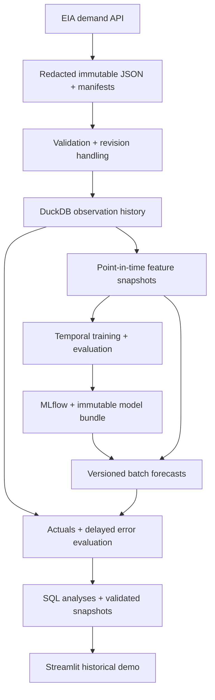

# GridCast — Electricity Demand Forecasting & ML Operations

**Architecture and AI implementation guide for Purav Desai**  
Version 1.0 · 11 October 2026 · All planning dates use Asia/Kolkata

> Status: this is a proposed architecture, not a completion report. No GridCast code, models, forecasts, API connections, Snowflake objects, benchmark results, or deployed services are claimed to exist yet. Give this file to the coding agent as the project specification. Implement and prove the local release first; Purav personally executes every Snowflake operation afterward.

## 1. Why this is your next project

Choose **GridCast**, the energy forecasting project from the original three-project plan. Your supplied latest resume already includes MobilityOps, an A/B testing and causal inference project, football prediction, Olist e-commerce analytics, customer churn analysis, and an AI engineering internship. Another retail dashboard would overlap with several existing projects. GridCast adds a different kind of engineering evidence: an API-fed forecasting system with temporal evaluation, experiment tracking, model selection, versioned batch scoring, and operational monitoring.

MobilityOps establishes that you can turn source records into trustworthy analytical tables. GridCast should establish that you can turn a time-dependent data feed into reproducible predictions and explain when those predictions should be trusted. Your existing football model helps with regression/modeling concepts, but does not make point-in-time forecasting, delayed labels, or model lifecycle management redundant.

The strongest positioning is **Data/AI Engineer**, with useful evidence for data engineering and analytics engineering applications. This is a portfolio design judgment based on your resume, not a claim about a measured number of vacancies. Do not replace your strongest resume project automatically: compare the finished evidence with the role's requirements.

### One-sentence description

GridCast ingests hourly electricity-demand observations, creates features using only information allowed at a forecast cutoff, compares a compact ML model with a seasonal baseline, and publishes versioned next-24-hour forecasts, error analyses, and health status through a portable dashboard.

### Business users and decisions

| User | Question | Project output | Practical limitation |
| --- | --- | --- | --- |
| Energy planning analyst | What demand profile should I expect over the next 24 hours? | Hourly forecast with origin, units, model version, and fallback status | Portfolio forecasts are not approved dispatch instructions |
| Operations analyst | When does the model struggle? | Error by horizon, local hour, weekday, and high-demand period | Historical error does not guarantee future performance |
| Data/ML engineer | Did the feed, features, model, or publication fail? | Source freshness, data coverage, run receipts, model lineage, failure codes | Local monitoring is a bounded batch implementation |
| Recruiter | Can I inspect the project without cloud credentials? | Committed demo snapshots, screenshots, CI, model card, walkthrough | Snapshot content is historical and clearly dated |

No procurement savings, avoided outages, customer impact, or production users may be claimed without independent real-world evidence.

## 2. Release boundaries

### Required local release

1. One EIA balancing authority, initially **PJM**, subject to metadata and coverage verification.
2. Approximately two years of hourly demand, primarily calendar years **2024–2025**, with explicitly recorded boundary padding for labels and lags.
3. Bounded API extraction, cache reuse, source revisions, typed observations, gap reporting, and provenance.
4. Daily forecast origins at **00:00 UTC**; 24 hourly targets after each origin.
5. Same-hour-last-week baseline and one scikit-learn histogram gradient boosting candidate.
6. Point-in-time feature contract, rolling validation, frozen final test, model selection, and a model card.
7. MLflow local tracking and registry, an immutable model bundle, and an explicit serving release pointer.
8. Duplicate-safe forecast storage, delayed outcome evaluation, fallback and unavailable behavior, and recovery evidence.
9. SQL business/error analyses, a snapshot-only Streamlit dashboard, offline CI, screenshots, and measured resume evidence.
10. A PowerShell-friendly CLI and one orchestration implementation that actually executes the local stages.

### Optional after the local release passes

Manual Snowflake feature preparation, model registration, batch inference, parity verification, and export. Optional prospective data collection can begin once Purav supplies an EIA key; classify it separately from historical backtesting.

### Explicitly deferred

Weather, multiple authorities, deep learning, probabilistic intervals, automatic retraining, online feature stores, Kafka, Kubernetes, Spark, paid LLM calls, Cortex, S3 infrastructure, live public inference, and a separate FastAPI service. Docker/Airflow may be added after the working CLI, but their absence must not block completion. Do not create decorative DAGs or add unused tools to the stack.

### Completion order

Local reproducibility → measured forecasting and recovery → recruiter packaging → user-run Snowflake integration. A model beating the baseline is desirable, not a completion requirement. A tested seasonal baseline is a valid champion when the candidate loses.

## 3. Architecture and ownership



| Component | Owns | Must not own |
| --- | --- | --- |
| EIA client | Metadata discovery, bounded requests, retries, redaction, request receipts | Modeling, silent filling, credentials in saved responses |
| Normalizer/loader | Typed observations, versions, validation, gap reports | Deleting older revisions or inventing values |
| Feature builder | Cutoff-safe inputs and feature lineage | Reading future target actuals |
| Trainer/evaluator | Candidate training, baseline comparison, temporal splits | Random splitting or tuning on the final test |
| MLflow | Experiment records, registered candidate versions, artifacts | Automatically making a model safe to serve |
| Release manager | Validated bundle and one authoritative serving pointer | Promoting on test results or registry recency alone |
| Batch scorer | Forecast identities, exactly 24 outputs or explicit unavailable run | Retraining or silently changing the model |
| Outcome evaluator | Versioned actual/error joins when labels arrive | Rewriting forecasts after observing outcomes |
| Workflow CLI | Dependencies, retries, stage receipts, failure propagation | Claiming a partial run is complete |
| Dashboard | Reading verified small snapshots | Querying EIA, MLflow, or Snowflake during a recruiter visit |

**DuckDB is the local analytical store; SQLite stores MLflow metadata.** They serve different purposes. Local training and inference use the same Python feature implementation. Snowflake is a later execution target with a parity gate, not a second independently invented forecasting policy.

## 4. Environment and resource plan

Create a **new GridCast folder and project-local environment**. Preserve MobilityOps and its environments. The earlier reported machine has Windows 10, PowerShell, and about 5 GB available RAM; do not assume Docker or large memory is available.

Prefer an installed, compatible **Python 3.12 or 3.13** for the new local project. Inspect available interpreters first. The MobilityOps Python 3.14 environment is not proof that every GridCast dependency is compatible. If only 3.14 is present, probe package compatibility in a new environment and document the result; do not change global packages or silently install an interpreter. Give Purav a short interpreter setup instruction if needed while continuing architecture/fixture work independently.

| Group | Packages/tools | Purpose |
| --- | --- | --- |
| Data/core | requests, pandas, NumPy, PyArrow, DuckDB, PyYAML, Pydantic, tzdata | API, typed data, files, database, configuration, Windows timezone rules |
| ML | scikit-learn, MLflow, joblib | One compact model, tracking/registry, trusted local serialization |
| Presentation | Streamlit, Plotly | Portable dashboard |
| Development | pytest, Ruff | Behavioral checks and lint |
| Later Snowflake environment | snowflake-snowpark-python, snowflake-ml-python; connector only if needed | User-run feature preparation, registry, warehouse scoring |

Maintain `requirements/local.in` plus its resolved lock and, later, `requirements/snowflake.in` plus its lock. These are two dependency groups, not a forest of unused environments. Confirm compatible versions from current official documentation and actual install/import checks. Do not invent version pins in advance.

CPU only; set explicit thread limits, start with two workers/threads at most, and train folds sequentially. Use a compact tree model and a small parameter search. A two-year series is tens of thousands of observations, not millions. Twenty-four feature rows per origin are horizon examples, not twenty-four new source measurements.

## 5. Source contract and ingestion

### Source discovery

Use the official EIA API v2 route:

```text
Metadata: https://api.eia.gov/v2/electricity/rto/region-data/
Data:     https://api.eia.gov/v2/electricity/rto/region-data/data/
```

At implementation time, verify the route's frequency, respondent facet, demand type, unit, date range, and timestamp/interval meaning. Planned filters are `respondent=PJM`, `type=D`, `frequency=hourly`, and `data[0]=value`. Treat these as settings to verify, not a fabricated API response. Save a sanitized metadata receipt and official respondent description. If PJM lacks sufficient usable coverage, select one alternative such as CISO only after documenting the reason; do not mix authorities into the same model.

EIA requires a free API key, supports metadata discovery, returns values that need numeric parsing, and limits a JSON response to 5,000 rows. Use explicit pagination and deterministic sorting. EIA responses can echo request parameters, including credentials: sanitization is necessary before saving or logging a response. See the official documentation in section 25.

### Windows credentials

Purav obtains the EIA key and supplies it through an environment variable or ignored `.env`. Commit `.env.example` containing placeholders only. The agent must not request that a key be pasted into public logs or chat. Treat prepared request URLs, HTTP exceptions, response echoes, and debug logging as possible leak paths.

No key available: complete mocked API tests, fixtures, CLI, features, and demo plumbing; clearly mark real-data completion blocked. A synthetic fixture is never a substitute for real-data resume claims.

### Extraction policy

- Fetch one authority/type in bounded monthly windows; use an internal half-open interval convention and normalize upstream inclusive bounds after retrieval.
- Set page size at most 5,000 and sort by period plus relevant identity fields. Validate reported totals, page count, duplicate identities, requested bounds, and returned facets.
- Use connect/read timeouts. Retry bounded network errors, HTTP 429, and selected 5xx responses with backoff/jitter and `Retry-After`; reject authentication and contract errors promptly.
- Stage the entire window before publication. If totals change during pagination or pages conflict, discard that incomplete window and retry it; do not mix unrelated attempts.
- A matching cached request receipt may be reused offline. An explicit refresh of a recent overlap window is how revisions are discovered; request identity alone does not prove the source is unchanged.
- Start with a seven-day overlap policy for later refreshes. This is a project setting, not an assertion about EIA revision timing. Periodic broader audits remain necessary.

### Preserved artifact

Remove secrets and secret-bearing echoed fields; retain the data payload and non-sensitive metadata. Save canonical redacted JSON and compute its SHA-256. This checksum identifies the **persisted sanitized artifact**, not the original unredacted HTTP wire bytes. Record sanitizer version, UTC fetch time, sanitized request fingerprint, page offsets, response version, row count, unit, and date bounds.

An observation's business identity is `(authority, metric, observation_time_utc)`. Its version additionally includes canonical value/unit payload hash. The same logical record on two pages is not two observations. Same key and different values in one staged window is a conflict, not a latest-row-wins shortcut.

### Typed observation validation

Required: authority, metric, UTC-aware observation timestamp, finite parsed value, unit, artifact ID, and first-seen time. Preserve raw value text. Negative demand is rejected by this project's demand contract; do not apply that rule to generation/interchange metrics without their own policy. Zero demand is retained and flagged for review. Extreme positive demand is flagged, not automatically removed from labels to improve scores.

Missing values remain missing. Generate an hourly UTC grid to identify gaps; never use backward fill, interpolation through future measurements, or zero-fill labels. Report source rows, distinct observations, accepted/rejected versions, gaps, and revisions separately.

### Units and time

Keep the source unit verbatim. Planned demand measurements are hourly energy, commonly represented in MWh; verify before selecting display labels. MWh and MW are different dimensions. The numerical correspondence for average power over exactly one hour is not permission to relabel every value.

Internally use UTC-aware timestamps. Configure the selected authority's local timezone, initially `America/New_York`, after verification. Convert only for calendar features/display. Keep local offset and DST fold information when interpreting repeated hours. UTC remains the unique time axis. Document whether the upstream period labels an interval start or end; normalize to `observation_time_utc` as the **interval end** before feature logic. Block real-data forecasting if this mapping is unresolved.

## 6. Revisions and point-in-time modes

Historical data downloaded now may already contain revisions. GridCast must support two explicitly different modes:

| Mode | Which version can features read? | Availability rule | Permitted claim |
| --- | --- | --- | --- |
| Retrospective backtest | Version from a frozen historical source snapshot | Simulated availability = normalized interval end + 3 hours | Cutoff-safe under a declared delay assumption; historical vintages not reconstructed |
| Prospective collection | Most recent valid version actually seen by the forecast cutoff | First seen in this system at or before the cutoff | Reproducible forecast from data this collector had seen |

Three hours is a conservative project assumption to test, **not a verified universal publication SLA**. Evaluate 2/3/6-hour delay sensitivity on validation only if time allows; keep the primary contract fixed before the final test. Historical `fetched_at` must not be falsified to look like historical availability.

In prospective mode, a revised version first seen tomorrow cannot enter yesterday's feature snapshot. Preserve all versions and actuals evaluation vintages. Even first-seen timestamps do not establish the provider's original publication timestamp or an external audit of what all market participants knew.

## 7. Data model and output grains

| Table/artifact | Grain/key | Essential fields |
| --- | --- | --- |
| `source_artifact` | One sanitized artifact checksum | Request fingerprint, fetch time, rows, sanitizer version, unit, coverage, path |
| `observation_version` | Authority × metric × interval-end UTC × payload version | Value, unit, first-seen time, artifact provenance, validation status |
| `observation_receipt` | Artifact × observation-version identity | Page/row lineage; repeated deliveries remain auditable |
| `observation_current` | Authority × metric × interval-end UTC | Latest valid version for current exploration; never a historical as-of substitute |
| `feature_snapshot` | Snapshot ID × horizon | Origin, target, feature version, mode, source snapshot, feature values |
| `feature_lineage` | Snapshot ID × input observation-version identity | Input time, availability time, feature name, chosen version |
| `model_release` | Release ID | Model/baseline identity, bundle checksum, training cutoff, selection policy, MLflow version |
| `forecast` | Authority × origin × target × release ID × feature snapshot ID | Horizon, prediction, unit, status, requested model, actual serving model |
| `forecast_attempt` | Attempt ID | Logical request identity, command, start/end, outcome, errors, row counts |
| `forecast_error` | Forecast identity × actual-version/evaluation-policy identity | Observed value, signed error, absolute error, evaluated-at UTC |
| `mart_model_health` | Evaluation window × release/mode × horizon or hour | Paired counts, errors, gaps, fallback rate, source/forecast age |

Do not put an attempt ID into a logical forecast key: retrying should not create a new forecast. Explicit model-release or input-snapshot changes create a new forecast version; they do not overwrite the previous result. Exactly one release pointer selects default serving; old releases remain inspectable.

Use typed floating-point numbers for energy and ML outputs, with explicit finite/range validation. This project is not monetary accounting and does not inherit MobilityOps' cent-rounding contract. Record numerical comparison tolerances where local and warehouse operations can differ.

## 8. Forecast contract and safe features

Let `C` be the issuance/decision cutoff in UTC. Let `h` range from 1 through 24. The target interval end is `T = C + h hours`; the forecast predicts the energy for the interval ending at `T`. The first target is the hour immediately after `C`. This notation depends on the verified interval-end normalization.

Under the retrospective three-hour delay assumption, an observation is usable only when `observation_time + 3 hours <= C`. Calendar information for the future target is known; future realized demand is not.

### Required initial features

| Feature | Definition | Why available |
| --- | --- | --- |
| `horizon` | 1–24 | Forecast contract |
| Calendar | Target local hour/weekday/month, weekend, UTC offset | Known from target timestamp and configured timezone |
| Cyclic encodings | Sine/cosine for local hour and weekday | Deterministic calendar transformation |
| `target_lag_168` | Demand at `T - 168 hours` | At most `C - 144 hours`, comfortably before cutoff |
| `target_lag_336` | Demand at `T - 336 hours` | Earlier history |
| `latest_available_demand` | Last valid observation available by `C` | Availability-filtered lookup |
| `latest_age_hours` | `C - latest observation interval end` | Measures stale input explicitly |
| Recent mean/std/min/max | Trailing 24 and 168 clock hours ending at latest available observation | Fixed past windows, with coverage counts |
| Recent change | Latest available value minus value 24 clock hours earlier | Both values checked independently for availability |

Build one long-format row per `(origin, horizon)` and use one global regressor. Do not fit twenty-four independent models for the first release. Keep one shared feature builder for training and scoring.

**Do not use `target_lag_1` or `target_lag_24` indiscriminately.** For late horizons, those timestamps can lie after the allowed input boundary. Avoid them entirely in the initial feature version. Do not compute a target-specific rolling average that quietly includes hours after the origin.

Use a reindexed UTC hourly series and timestamp joins. Row-based `.shift(168)` on a gappy series can mean 168 records instead of 168 hours. Full windows record expected and present counts. Lag holes remain missing. The candidate can accept explicitly allowed missing features, but mandatory quality gates in section 12 still apply.

Keep labels in a separate dataset, attached only for training/evaluation. The scoring interface never receives target actuals. Features must not change if demand after `C` is modified, appended, deleted, or reordered.

### Example, not a project result

At `C = 2025-08-10 00:00 UTC`, horizon 24 predicts the interval ending `2025-08-11 00:00 UTC`. Its week-lag input ends `2025-08-04 00:00 UTC`. A previous-day target lag would end at the origin itself and is not available under the three-hour delay. This explains why familiar one-step forecasting examples cannot be copied directly into a 24-hour issuance contract.

## 9. Training and chronological evaluation

### Fixed planned periods

Verify coverage before sealing the following split specification:

| Purpose | Planned period | Rule |
| --- | --- | --- |
| Initial training history | January 2024–June 2025 | Eligible labels must be available by each fit cutoff |
| Validation fold 1 | July 2025 | Fit on earlier eligible history |
| Validation fold 2 | August 2025 | Expanding history; no August/future labels at fit |
| Validation fold 3 | September 2025 | Expanding history; no September/future labels at fit |
| Frozen final test | October–December 2025 | Final parameters chosen already; fit cutoff at test start |

Record exact UTC bounds and forecast origins in `config/splits.yaml`. Download guard intervals before/after the nominal period if needed for complete targets. Padding is separately counted. Do not publish an exact origin/row count until boundary rules and gaps have been evaluated.

Assign split membership by **forecast origin**, then check all target/availability boundaries explicitly. In validation, exclude an origin from the selection score if any of its 24 target labels would not be available by that fold's next fit boundary. In particular, September validation must not consume labels that become available after the October test-fit cutoff. Record purged origins instead of silently moving them into another split. Final-test origins may require a small January 2026 label guard interval; those labels belong to the test output window and must never enter model fitting. Pre-download at least 14 days of warm-up history before the nominal feature period when available; count it separately.

At a fit boundary, include a training example only when its **target label availability is at or before the fit cutoff**. Purge examples whose target crosses that boundary. Labels repeated across horizons/origins are not independent observations; keep the daily schedule and report origin counts and paired target counts separately.

Freeze and checksum the source snapshot, feature specification, split membership, candidate configuration search, selection policy, and evaluation code before the final test. Keep the final test file out of exploratory selection scripts. An audit artifact should show when its evaluation first ran.

### Baseline

`prediction(T) = observed_demand(T - 168 hours)` under the same availability/version rules. The baseline has a versioned policy and provenance even though it has no learned weights.

### Candidate

`HistGradientBoostingRegressor`, fixed random seed, initially squared-error loss, explicit **`early_stopping=False`** to avoid an internal randomly selected validation subset. A bounded four-configuration search may vary maximum leaf nodes and L2 regularization while holding learning rate/iterations fixed. Example starting bounds: 15/31 leaves, L2 0/1, maximum 150 iterations. These are starting settings to verify locally, not promised optimal parameters.

No random train/test split, random K-fold, or fitting transformations on all periods. If adding learned imputers or encoders, fit them only on each fold's training examples. Calendar mappings are deterministic; source-derived mappings need training provenance.

### Metrics and denominators

- `MAE = sum(abs(actual - prediction)) / paired valid target count`, in verified source units.
- `WAPE = 100 * sum(abs(actual - prediction)) / sum(abs(actual))`; denominator zero means unavailable, not 0%.
- Signed bias is mean `(prediction - actual)`; positive means overprediction.
- Horizon MAE uses the matched rows for that horizon.
- Peak MAE uses targets above a threshold fixed from the fold's training-label 90th percentile. It must not define a different peak cohort for each candidate.
- Report forecast-origin coverage, target coverage, exclusions, and missing actuals alongside scores.

Compare candidate and baseline on the **same eligible target pairs** and show each one's native coverage separately. Aggregate fold WAPE using combined absolute-error and actual sums, not an unweighted average of percentages. Compute daily summaries with explicit denominators. Use whole-day grouping if reporting uncertainty; do not pretend 24 adjacent horizons are independent samples.

### Selection rule fixed before the test

Promote the candidate for the first release only if it has at least **2% relative validation WAPE reduction**, peak MAE no worse than **1.05 × baseline peak MAE**, and meets the same declared coverage gates. The 2%/1.05 values are project governance thresholds, not external standards. If baseline WAPE is zero or required peak comparisons are unavailable, do not force an improvement calculation; choose the valid baseline and record why.

Initially require at least 90% of scheduled validation origins to have complete 24-target actuals and valid predictions for both methods before making a candidate-improvement claim. Report every exclusion, including quality-gate failures. This threshold is also a project choice; if source coverage makes it inappropriate, amend and document it before sealing selection, never after looking at the final test. A baseline with valid operational outputs can still serve when the comparison is inconclusive, with that limitation disclosed.

Refit the selected candidate's fixed configuration on eligible history through the final fit cutoff, then evaluate the locked test once. Retain baseline scores. Do not switch champions because the test looks better for another candidate. If you redesign after viewing test results, record the first test and designate a new holdout or prospective evaluation; the old test is no longer untouched.

### Model card

Include intended use, authority, unit, period, source revision limitation, delay assumption, features, fit cutoff, validation selection, test metrics, coverage, high-demand errors, fallback policy, package versions, known limitations, and prohibited claims. No unverified accuracy percentages.

## 10. MLflow, bundles, and release control

Use an explicit SQLite-backed MLflow URI in an ignored `state` folder and a local artifact store. Resolve paths from the project root; do not depend on the shell's current directory. MLflow's registry requires a database-backed store; see its official guide.

For each candidate/fold/final fit, log: authority; data snapshot ID; feature version; availability mode/delay; train/validation bounds; label cutoff; seed; parameters; metrics; coverage; package versions; git commit when available; duration; model artifact; split receipt; leakage report; evaluation tables.

Register trained candidate versions using the selected MLflow version's supported API. Never resolve serving by “latest version.” Do not invent registry versions for a seasonal baseline; register the trained candidates, and represent baseline releases with their immutable policy bundle.

The serving bundle includes the trusted local model, ordered feature schema/dtypes, baseline policy, metadata, model card, and checksums. Serialize only locally produced trusted artifacts. Joblib/pickle artifacts can execute code: the app never loads arbitrary user uploads.

`releases/current.json` is the authoritative local serving pointer. Validate a new bundle before atomically replacing that pointer. A failure leaves the old release selected. Write a durable release receipt and then update the MLflow `champion` alias for a trained-model champion as a reconciliable mirror. The alias is not the transactional source of truth; a mirror failure is recorded and retryable. Baseline champions have an explicit baseline pointer, not a misleading trained-model alias.

Distinguish a frozen evaluated model from a future deployment refit. If refitting on data beyond the test, preserve the tested artifact and label the new deployment's inherited validation evidence and absence of its own frozen-test result. Do not overwrite test history.

## 11. Batch inference, idempotency, and publication

1. Resolve the release once and verify its bundle/schema checksum.
2. Freeze the source version view and construct the origin's feature snapshot.
3. Apply the data gates and determine the serving path.
4. Generate the full 24-horizon output in memory; validate finite non-negative predictions and timestamps.
5. Commit feature snapshot, lineage, forecasts, and successful receipt in one DuckDB transaction.
6. Generate analysis/snapshot files into a temporary generation.
7. Validate complete files and publish with a completed manifest; preserve the previous valid generation on failure.

Non-negative predictions may be clipped at zero only through an explicitly versioned output policy applied in training evaluation and inference; record the count of clipped predictions. Do not silently alter negative values in only one path.

A replay of the same logical forecast identity must yield the same checksum and insert zero extra forecasts. A checksum conflict for that identity is a hard nondeterminism error. A changed source snapshot or release creates a distinct version, explicitly labeled. On injected failure after horizon 12, the transaction must leave zero new forecasts for that request. Log the failed attempt separately after rollback.

The database commit and snapshot file publication are separate stages, not one distributed transaction. If the DB succeeds and export fails, mark export pending and rerun export without duplicating forecasts. Never claim an all-or-nothing boundary across unrelated stores.

## 12. Missing data, fallbacks, freshness, and recovery

### Initial candidate input gates

- Latest available observation age no more than six hours at issuance.
- Recent 24-hour window at least 22 valid hourly values; weekly window at least 160 of 168.
- At least 22 of 24 target week-lag values present.
- Feature/model schema and selected release valid.

These are project settings to record in YAML and test. They are not energy-industry safety standards. Candidate scoring can tolerate allowed missing features only after these gates pass.

If the candidate path fails, use seasonal baseline only when **all 24 required week-lag values** are valid and available at the cutoff. Otherwise publish a run receipt with `UNAVAILABLE` and zero numeric forecast rows. A complete 24-hour batch or explicit unavailability is easier to interpret than quietly filling a few hours. Do not fabricate zero-demand forecasts.

Fallback status records both requested model and actual serving baseline. A corrupted selected model may use the baseline if its requirements are satisfied; automatic loading of an old model is deferred. Provide an explicit rollback command to select the previous validated bundle.

### Separate health concepts

| Health field | Meaning |
| --- | --- |
| Source age at issuance | Cutoff minus latest usable observation time |
| Collector age | Wall clock minus last successful API receipt time |
| Forecast age | Wall clock minus forecast issuance time |
| Target status | Future, now historical, or pending actual according to time |
| Evaluation status | Actual not arrived, invalid actual, or evaluated version |
| Serving path | Candidate, seasonal fallback, unavailable, or preserved prior snapshot |

Historical demo forecasts are always historical: age must not turn a 2025 backtest into an alarming “live outage.” Use `HISTORICAL_SNAPSHOT` mode and show data/evaluation dates. A prospective scheduler has separate freshness thresholds, initially a 26-hour expected daily publication window, configurable and labeled as a project policy.

Monitoring core: missingness, source delays, gap counts, fallback counts/rates, actual-label coverage, and trailing paired forecast errors. Optional drift screens may compare feature distributions to the training reference and flag them for inspection. Do not label arbitrary thresholds statistically validated drift detection or trigger automatic retraining.

Required recovery scenarios: HTTP 429/retry; partial API window; same-key conflicting source values; identical forecast replay; changed source revision; missing lag input; stale anchor; corrupted model bundle; interrupted forecast transaction; snapshot export failure. Each gets an expected outcome and actual evidence receipt.

## 13. Delayed outcomes and operational analysis

Evaluate a forecast only after valid actuals for its target interval arrive. Join by authority, metric, target UTC timestamp, and unit. Keep immutable forecast predictions and versioned actual/error results. A revised actual creates a new evaluation vintage, preserving the old error calculation.

The main retrospective score uses the frozen evaluation source snapshot. Prospective reporting must name whether it uses first-seen actuals or latest revisions. Do not combine these policies into one accuracy figure.

### Read-only SQL analyses

Provide four parameterized queries over a declared release/evaluation scope:

1. **Error by horizon:** MAE, WAPE, bias, paired rows, fallback count.
2. **Peak demand and error:** observed high-demand hours against the fixed training-derived threshold, underprediction frequency/magnitude, local hour/weekday profile.
3. **Demand profile:** daily/weekly seasonality and period-to-period changes, with coverage checks and UTC/local-time interpretation.
4. **Model health:** successful/unavailable batches, source age, fallback rate, pending-actual counts, and error trends by evaluation vintage.

Save CSV outputs, query hashes, scope, generation time, and a short `docs/business_findings.md`. Produce two or three real findings after execution, each with a number, denominator, period, and analyst implication. For example, “highest measured error occurs at [horizon]” can motivate review; it is not proof that procurement improved.

Use independent NumPy/Python recomputation of selected SQL metrics as a reconciliation check. Do not sum demand observations and call the result peak power. Keep demand/energy units on all charts.

## 14. Snapshot demo and recruiter access

### Snapshot contract

`demo/published` contains:

- `forecast_examples.parquet`: representative contiguous historical origins, all horizons, predictions/baseline/actuals and status.
- `evaluation_by_horizon.csv`: exact metric numerators, denominators, counts, and scope.
- `health_summary.json`: mode, lineage, source dates, runs, failure scenarios, coverage, and versions.
- `business_findings.json`: verified findings and query/evidence references.
- `model_card.md`: human-readable limitations and evaluation contract.
- `manifest.json`: schema version, release ID, source snapshot, checksums, sizes, provenance, generation UTC, and display mode.

Keep demo files small and aggregates bounded. The loader verifies relative-path containment, checksums, expected dtypes, unique forecast keys, valid horizons/units, timestamps, metric arithmetic, and coverage. Checksums establish consistency, not authenticity against a malicious editor who can rewrite the manifest.

### Three dashboard views

1. **Forecast Explorer:** select historical origin; show all 24 horizons, observed values where present, champion and baseline, status, unit, and release.
2. **Evaluation:** validation/test distinction, paired metrics, horizon/local-hour/peak comparisons, coverage and delay assumptions.
3. **Reliability & Model Lineage:** source/version health, fallback/recovery evidence, model card, training cutoff, source snapshot, and code/package versions.

Every view must be useful. Filters must either recompute scoped metrics correctly or leave global metrics labeled as fixed-scope; they must not silently change only the chart. The default app loads snapshots only and makes no EIA/Snowflake/MLflow/model-download call. Remove all keys and disconnect network to test this path.

Commit a public-ready source repository, sanitized sample fixtures, small snapshots, three genuine screenshots from the running app, a three-minute walkthrough script, architecture, model card, and CI evidence. Do not fabricate screenshots, benchmark outputs, or hosted URLs. Streamlit Community Cloud is optional after checking its current requirements and repository eligibility; a clean local demo plus committed evidence is the required baseline.

Add model/error scope directly to screenshots and README. A snapshot remains usable after Snowflake expires, but it does not become a continuously updated forecast.

## 15. Orchestration and CLI contract

Implement `python -m gridcast` with stages:

```text
generate-fixture
inspect-source
ingest
validate-source
build-features
backtest
seal-selection
evaluate-test
release
forecast
evaluate-outcomes
analyze
export-demo
validate-demo
verify-scenarios
run
```

These are required interface names to implement, not commands that already work. CLI arguments specify configuration, scope, UTC range/origin, mode, release, offline behavior, and outputs. Invalid configuration must fail before network or database mutation. Propagate subprocess failures; every command exits nonzero for failed required gates.

Use `run` for an explicit local dependency graph. Ingestion precedes normalization, features precede training/scoring, and actuals precede error metrics. Include analysis and snapshot export in the completion path so packaging is not an undocumented extra command.

Separate research/training workflow from daily inference. `run --mode daily` resolves an approved release, refreshes observations, scores, evaluates past targets, analyzes, and exports. It must not retrain or rerun the frozen test. `run --mode build` creates the initial local release and demo with a sealed selection boundary.

`evaluate-test` rejects an unsealed selection or a changed selection fingerprint. Repeating the identical sealed evaluation may verify/reuse the same artifacts, but must not erase its first-run receipt. A changed source/split/model experiment is a new evaluation version whose already-viewed test status remains visible.

### Starting configuration contract

The worker implements and validates this shape; it is a specification example, not an existing runnable configuration:

```yaml
project: gridcast
authority: PJM
metric: D
source_route: electricity/rto/region-data
frequency: hourly
calendar_timezone: America/New_York
forecast_origin_hour_utc: 0
horizon_hours: 24
availability:
  mode: retrospective
  assumed_delay_hours: 3
source:
  core_start: "2024-01-01T00:00:00Z"
  core_end_exclusive: "2026-01-01T00:00:00Z"
  warmup_days: 14
  label_padding_days: 2
  refresh_overlap_days: 7
  page_size: 5000
selection:
  minimum_relative_wape_improvement: 0.02
  maximum_peak_mae_ratio: 1.05
  minimum_paired_origin_coverage: 0.90
runtime:
  threads: 2
  snapshot_only_app: true
  allow_snowflake_execution_by_agent: false
```

Validate authority/unit/interval semantics independently; configuration alone does not establish the source contract. Store precise split membership and quality gates in their own small configuration sections/files and include them in the experiment fingerprint.

On Windows provide `scripts/run_local.ps1` using the project environment's Python directly. A user-controlled Windows Task Scheduler entry can call the daily CLI later. Do not create background schedules without the user's request. Prepared Docker/Airflow assets are optional and remain unexecuted until runtime evidence exists; if implemented, tasks must execute these stages and propagate failure, not print a checklist.

## 16. Repository plan and responsibilities

Keep files cohesive rather than enforcing arbitrary file counts. A reasonable planned layout:

```text
README.md
architecture.md
pyproject.toml
.env.example
.gitignore
config/                 project.yaml, splits.yaml, feature_contract.yaml
requirements/           local.in, local.lock.txt; later Snowflake group
src/gridcast/           cli.py, config.py, source.py, storage.py
                        features.py, training.py, evaluation.py
                        releases.py, forecasting.py, workflow.py, snapshots.py
sql/                    four analysis queries
app/                    streamlit_app.py
tests/                  behavior tests and small deterministic fixtures
scripts/                run_local.ps1, verify_scenarios.py
docs/                   model_card.md, business_findings.md
                        snowflake_steps.md, resume_evidence.md, demo_walkthrough.md
demo/published/         validated portable snapshots
assets/screenshots/     actual dashboard captures
.github/workflows/      offline-checks.yml
snowflake/              manual SQL/Python templates, only after local core
```

Ignored runtime directories: `data/raw`, `data/db`, large feature/model artifacts, `state`, local credentials, temporary generations, and bulky reports. Commit only small sanitized evidence needed for review. `architecture.md` must describe the implemented project at the end; this planning file is its starting specification, not proof of completion.

## 17. Verification strategy and CI

Write meaningful tests around failure-prone behavior, not a test for every wrapper. Use a deterministic synthetic hourly series with weekday/hour patterns and known revisions/gaps, enough history for week and two-week lags. Mark fixture results visibly.

Required checks:

- API pagination, totals, facet mismatch, timeouts, retry bounds, inclusive-window normalization, and secret redaction including echoed request fields.
- Repeat delivery versus changed observation version; transaction rollback and retry.
- UTC/DST conversion, repeated local-hour distinction, clock-hour lag joins with gaps, and unit validation.
- Future-data mutation test: change all inputs after an origin and prove feature/prediction checksum unchanged.
- Revision test: a version first seen after the cutoff cannot enter an earlier prospective feature snapshot.
- Fit cutoff/label boundary purge; no test IDs in tuning; no internal random validation.
- Baseline correctness, candidate/baseline paired metric arithmetic, zero WAPE denominator, peak threshold lineage.
- Forecast replay adds zero rows; failure halfway through writes none; changed release/input produces explicit new version.
- Missing data causes expected baseline or unavailable status; corrupted bundle detected.
- Snapshot publication preserves prior valid generation; no-key offline app render/loader check.

CI on Linux uses the same resolved compatible Python/dependencies: native Ruff, pytest, a small fixture workflow, compact training/scoring, SQL analysis, export validation, and selected recovery scenarios. No EIA/Snowflake secrets, full historical download, or large training search in normal CI. A scheduled/manual real-data job is a separate optional integration.

Prepare a workflow first, then record a genuinely passing GitHub run on the exact implementation commit. A YAML file alone is not evidence that CI ran. If the worker lacks GitHub access, finish local checks and give exact user push/verification steps; label hosted CI pending.

## 18. Build plan and completion gates

Aim for **12–16 focused sessions of 2–4 hours**, with a calendar target of **30 October**, leaving 31 October and 1–4 November for contingency. This estimate assumes one authority, no weather, and a compact model. Do not promise completion in a fixed number of days regardless of integration blockers.

| Sessions | Slice | Exit evidence |
| --- | --- | --- |
| 1–2 | Environment, source metadata, fixtures, bounded ingestion | Imports/locks, sanitized metadata, real or clearly pending source receipt |
| 3–4 | Observation versions, UTC grid, availability features | Revision/gap reports and leakage tests |
| 5–7 | Baseline, rolling validation, MLflow, locked selection | Fold receipts, selection decision, versioned candidate artifacts |
| 8–9 | Frozen test, releases, scoring, delayed errors | Paired test metrics, model card, forecast/recovery checks |
| 10–11 | SQL findings, dashboard, end-to-end export | Actual findings and no-key snapshot validation |
| 12–13 | CI, screenshots, documentation, resume evidence | Reproducible clean fixture run and evidence index |
| 14–16 | Contingency or user-run Snowflake pilot | Actual integration evidence or honestly pending integration |

**Local done** means all required capabilities pass, real data has been processed, temporal evaluation is published, the chosen champion is honestly justified, replay/failure cases are demonstrated, the snapshot app works without credentials, and documentation distinguishes every execution mode. A synthetic-only build or dashboard without evaluation is incomplete.

## 19. Division of work

| Group | Coding agent | Purav |
| --- | --- | --- |
| Local setup and implementation | Create new environment/files, resolve compatible dependencies, run local checks | Provide interpreter/key setup if missing; learn from the completed implementation |
| Data and ML correctness | Implement source contracts, temporal features, tests, selection, metrics, receipts | Review assumptions and explain them in interviews |
| Packaging | README, implemented architecture, model card, SQL findings, genuine screenshots, CI files | Supply authorized repository destination and optionally record walkthrough |
| External publication | Prepare a reviewable repository/demo; use only authorized GitHub scope | Approve or perform publication where authorization is absent |
| Snowflake | Generate and explain exact manual scripts, checks, expected outcomes, troubleshooting | Execute every connection, SQL statement, upload, Snowpark run, registry action, inference, and cleanup |

Do not use arbitrary percentages of “AI versus manual” as a measure of project ownership. Purav should be able to defend architecture, availability rules, selection policy, limitations, and actual evidence regardless of who typed the files.

## 20. Manual Snowflake implementation — after local completion

**Hard boundary:** the coding agent must not connect to Snowflake, run `dbt debug`, inspect account objects, upload data, execute SQL, run a Snowpark session, register a model, or invoke warehouse inference. It prepares commands and waits for Purav to execute them. Snowflake work is not required for the locally complete resume version.

### Step 1 — Inspect the account yourself

Confirm actual trial expiry/balance, permissions, region, supported warehouse/runtime/package options, and planned spend. The original planning envelope was about **$35** for GridCast; treat that as a personal cap to translate using account pricing, not a guaranteed charge. Do not assume the remaining balance equals the original trial allocation.

Create dedicated project database/schema and a standard X-Small warehouse if permitted. Configure auto-suspend, auto-resume, statement timeouts, query tags, and a resource monitor where applicable. Review storage and features outside monitor coverage separately. Prefer coarse batches; suspend compute after demonstrations.

### Step 2 — Establish secrets and a smoke test

Use a separate compatible Snowflake environment. Follow the account's supported authentication method. Keep credentials outside Git and public outputs. The agent gives you a minimal connection query and expected result; **you run it** and share only sanitized success/error details.

### Step 3 — Create storage objects

Prepare `RAW`, `FEATURES`, and `ANALYTICS` schemas or similarly clear ownership boundaries. Use an internal stage and a Parquet format. Stage typed observation versions exported from the local run; carrying UTC timestamps as explicit ISO UTC strings and converting with a validated cast can avoid ambiguous timestamp inference.

Suggested tables: raw versions and receipts, typed observations, frozen origin feature rows, model release metadata, forecasts, forecast errors, and model-health aggregates. Preserve authority, metric, unit, version, first-seen time, and historical/prospective mode. Standard Snowflake table uniqueness constraints must not be assumed to enforce duplicate safety; deduplicate staged inputs and implement deterministic merge predicates and conflict checks.

### Step 4 — Load a small bounded sample first

You execute the supplied `PUT`, `COPY`, validation, and merge steps. Compare distinct keys, row counts, units, date bounds, revisions, and source checksum receipts with the local export. Repeat the sample load and prove no extra logical observation versions appear. Load the full bounded series only after the sample passes.

### Step 5 — Reproduce feature preparation in Snowpark

The agent produces a user-run script that joins normalized UTC hours, applies identical availability/version rules, creates the same 24 origin/horizon rows, and preserves feature names/order/types. Build from typed observations rather than quietly uploading locally precomputed features and calling that Snowpark feature engineering.

Select several fixed origins: ordinary days, a gap, a revision, and DST transitions. Export results and compare them to local fixtures/snapshots. Categorical/calendar/horizon values must agree exactly; numeric values use declared tight tolerances. Windows, timezone conversion, missing values, and standard-deviation conventions need explicit parity checks. Block warehouse scoring if features disagree.

### Step 6 — Register the actual trained candidate

Snowflake Model Registry supports common scikit-learn models, but runtime dependencies, permissions, model signatures, and warehouse eligibility still require an account-specific test. The agent prepares a minimal registration script using the already trained trusted model, exact feature signature/sample inputs, pinned compatible dependencies, and warehouse target options supported by the chosen version. **You execute it.**

Time-box this pilot to one focused session. If the selected champion is seasonal baseline, do not falsely claim ML inference is the serving path: you may demonstrate candidate registry inference separately while retaining the baseline as champion. If registration is blocked, retain local scoring and record the integration limitation.

### Step 7 — Invoke warehouse batch inference and verify

You invoke the registered candidate on the frozen parity-tested feature rows, preserve explicit model version, and store the resulting predictions with their full identities. Compare local and warehouse outputs using an agreed tolerance and report maximum/median difference. No silent change of model/runtime or feature order.

A valid integration proves feature parity, output parity, duplicate-safe forecast persistence, and matching evaluation definitions. A model merely appearing in the registry proves registration, not scoring.

### Step 8 — Analyze and export portable evidence

You run the warehouse SQL error analyses, export a bounded result snapshot, and compare metrics with the local evaluation scope. Label the demo's execution origin `LOCAL` or `SNOWFLAKE` explicitly. Test that the app reads exported files without credentials. Archive sanitized query IDs, package/runtime versions, durations, and actual usage information when available.

### Step 9 — Optional schedules, then cleanup

Manual end-to-end execution comes first. If you later add a warehouse Task or Airflow integration, use one owner for each processing boundary, keep schedules suspended by default, and you enable them deliberately. Streams/Tasks are not required just because MobilityOps uses them.

After the demonstration, suspend schedules/warehouses, inspect usage, preserve needed exports, and remove only explicitly disposable objects. Update the resume only for operations actually executed successfully.

### Required manual guide format

For every Snowflake step, `docs/snowflake_steps.md` must contain: what it does, why it exists, prerequisites/permissions, exact command or complete script, placeholders, expected output/check, recovery, and cost cleanup. Explain one operation at a time when Purav starts this phase, without the agent running it on his behalf.

## 21. Numerical evidence and Google XYZ resume preparation

Create `docs/resume_evidence.md` after execution. Extract actual distinct observations, padded/core periods, valid origins, paired predictions, gap/revision counts, baseline/candidate WAPE/MAE, high-demand error, forecast replay insert counts, recovered scenarios, CI run, and processing time only if measured reproducibly.

Do not confuse observation count with horizon-training rows or paired forecasts. Do not claim a better forecast if the selected model loses to the baseline. Keep historical test, fixture recovery, prospective collection, and Snowflake pilot metrics separate.

Templates, **not achieved claims**:

- “Built reproducible 24-hour electricity-demand forecasts across [N valid origins], measured by [MAE] and [WAPE]% on a frozen temporal test, using cutoff-safe features, scikit-learn, and MLflow.”
- “Reduced validation WAPE by [P]% relative to seasonal naive on [paired targets], using rolling-origin evaluation and [verified model configuration].” Use only when truly measured; specify validation versus test.
- “Verified duplicate-safe forecast processing with zero additional rows across [R replays] and [F/F] expected recovery outcomes, using versioned inputs, transactional scoring, and explicit fallback policies.”
- “Delivered a credential-free forecast demo with [verified views/analyses] and reproducible CI, using SQL error marts and checksum-validated Streamlit snapshots.”

Support each with the exact local evidence file or passing commit/run. Never fill brackets with targets or guesses.

## 22. Explanation the agent must provide after building

Rewrite root `architecture.md` around what actually exists and explain in simple words with technical detail:

1. The business problem and why this complements MobilityOps.
2. End-to-end flow, inputs/outputs, each component's purpose, and ownership.
3. One real source observation becoming 24 feature rows and forecasts, with timestamps.
4. Why three-hour delay is an assumption and historical revisions limit claims.
5. Clock-hour lags, UTC/local time, DST, and the future-data mutation test.
6. Training, validation, frozen test, label purging, and baseline selection.
7. Actual results with denominators, coverage, and meaningful limitations.
8. MLflow runs/registry versus a serving release; how replay and rollback work.
9. Failure scenarios and where the last valid demo survives a failure.
10. CLI, modules, schemas, dependency choices, and how to reproduce locally.
11. What remains pending in Snowflake and the exact manual route.
12. Interview questions and short answers grounded in the implemented evidence.

Use rendered Mermaid diagrams and exact tables where useful. Do not replace explanation with jargon or an unrelated forecasting tutorial. Label all examples that are not actual results.

## 23. Copyable instruction for the worker agent

> Implement the local GridCast release described in this file in a new project folder, preserving MobilityOps. Work autonomously through setup, fixtures, real-data ingestion when a key is available, point-in-time features, temporal evaluation, MLflow, release control, transactional scoring, SQL analysis, dashboard, tests, CI assets, screenshots, and documentation. Do not stop after each milestone; resolve routine reversible choices and continue until the local completion gates pass or a genuine external prerequisite blocks dependent work. Continue independent work around blockers. Do not access Snowflake. Do not fabricate credentials, measurements, screenshots, CI runs, forecast improvements, production claims, or completed cloud integrations. Use installed compatible tools, verify dependencies in the new environment, preserve a clear evidence trail, and keep core scope bounded. Seal validation selection before evaluating the final test; never tune against test outcomes. At completion produce the implemented root architecture.md, model card, measured Google XYZ evidence, README reproduction steps, and a complete manual Snowflake guide. Explain the actual project to Purav after building it. Publishing a new repository, hosting a service, or creating schedules requires existing explicit authorization; preparing their files and local evidence does not.

## 24. Risks to manage and design rationale

| Decision/risk | Rationale/response |
| --- | --- |
| One authority | Focuses effort on correctness; more authorities multiply coverage/timezone checks |
| API key dependency | User supplies free key; offline fixtures keep engineering moving |
| Modest dataset size | Forecasting depth matters; do not compete with MobilityOps on volume |
| Revised historical data | Freeze snapshots and disclose retrospective assumptions; collect prospective versions separately |
| Publication delays | Availability rules and staleness gates; do not assume latest hour is known |
| Model underperforms | Serve valid baseline and publish honest comparison |
| No weather in core | Avoid future-weather leakage and additional integration deadlines |
| Histogram tree instead of another XGBoost project | Compact CPU model keeps attention on lifecycle and temporal validity |
| MLflow/SQLite overhead | Adds actual experiment/version management without external servers |
| No dbt in core | Existing MobilityOps already demonstrates dbt; SQL remains central for analysis |
| No mandatory Docker/Airflow | Native CLI provides executable orchestration on the current laptop |
| Snapshot serving | Recruiter access survives key/account expiry and does not consume cloud credits |
| Snowflake as a separate manual phase | Respects user ownership and keeps local completion independently demonstrable |
| Limited business claims | Planning insight and measured error are supported; realized savings are not |

## 25. Sources and evidence status

Design basis: Purav's supplied `Resume_Latest.pdf` and the original three-project portfolio blueprint. Resume accomplishments are user-supplied evidence; this guide does not independently audit those repositories or numbers. GridCast architectural choices, thresholds, splits, and effort estimates are proposed here.

Primary technical references checked 11 October 2026. Recheck version-specific APIs during implementation:

- [EIA Open Data](https://www.eia.gov/opendata/): official data access and key registration.
- [EIA API technical documentation](https://www.eia.gov/opendata/documentation.php): metadata, facets, pagination, string values, credential echoes, and request behavior.
- [EIA hourly region-data browser](https://www.eia.gov/opendata/browser/electricity/rto/region-data): inspect selected series and metadata.
- [EIA Hourly Electric Grid Monitor](https://www.eia.gov/electricity/gridmonitor/): source context; preliminary data status must be respected.
- [scikit-learn histogram gradient boosting regressor](https://scikit-learn.org/stable/modules/generated/sklearn.ensemble.HistGradientBoostingRegressor.html): estimator parameters and supported losses.
- [scikit-learn lagged time-series example](https://scikit-learn.org/stable/auto_examples/applications/plot_time_series_lagged_features.html): temporal evaluation guidance; adapt its one-step example to this explicit issuance contract.
- [MLflow backend stores](https://mlflow.org/docs/latest/self-hosting/architecture/backend-store/): database-backed tracking/registry architecture.
- [MLflow local database tutorial](https://mlflow.org/docs/latest/ml/tracking/tutorials/local-database/): local tracking workflow.
- [Snowflake Model Registry](https://docs.snowflake.com/en/developer-guide/snowflake-ml/model-registry/overview): supported models, signatures, dependencies, and execution-target requirements.

The EIA API has not been queried with Purav's key here. PJM coverage, exact respondent metadata, interval mapping, units, source row counts, model scores, and warehouse compatibility remain implementation gates. No market-demand percentages or guaranteed forecast improvements are inferred from these technical references.
